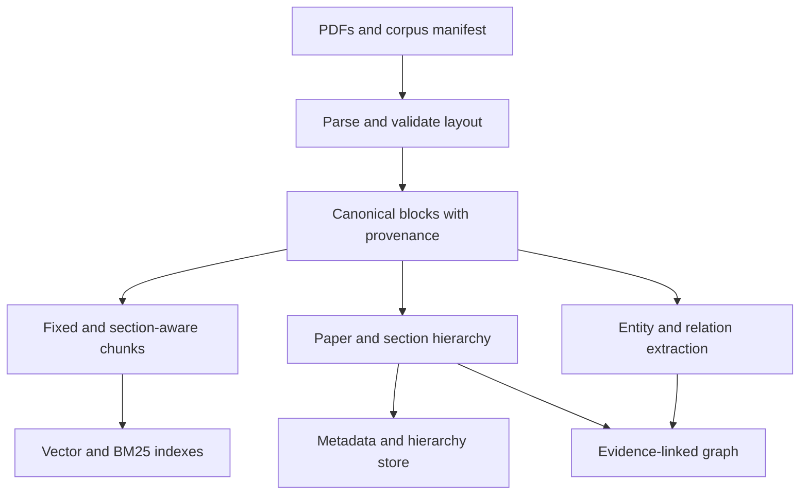
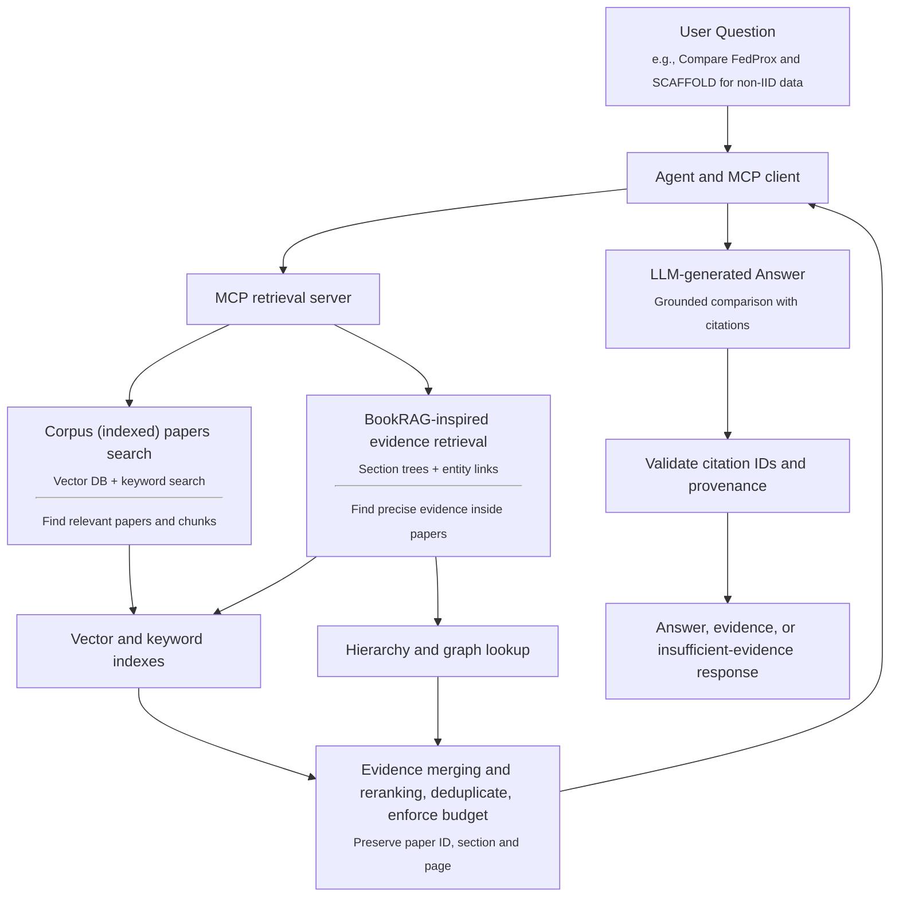

# FedResearch

**A structure-aware, agentic RAG assistant for federated-learning research papers.**

Status: **planning only**. This repository blueprint and implementation plan are the first deliverables. The application, commands, configuration files, indexes, and results described below are planned; they do not exist yet.

FedResearch will answer technical questions using a curated PDF corpus, retrieve supporting passages, and cite the paper, section, and PDF page. It will combine corpus-level search with document hierarchy and a small evidence-linked knowledge graph inspired by BookRAG.

## 1. Project goal

Build and evaluate a research assistant that can:

- Explain a method using passages from its original paper.
- Connect a method's description, assumptions, and experimental evaluation across sections.
- Compare methods across papers, with evidence from each paper.
- Summarize approaches represented in the indexed corpus.
- State when the corpus does not contain sufficient evidence.

Example questions:

1. How does SCAFFOLD address client drift, and where is its effectiveness evaluated?
2. How do FedProx and SCAFFOLD differ in their treatment of statistical heterogeneity?
3. Which approaches in this corpus address non-IID client data, and what limitations do their authors describe?

These examples become benchmark questions only after their answerability and source passages have been checked against the selected PDFs.

**Research question:** Does preserving document structure improve evidence retrieval and grounded question answering over federated-learning papers, compared with conventional chunk-based RAG?

**Secondary question:** Does a small knowledge graph improve cross-section and cross-paper evidence coverage beyond hybrid, structure-aware retrieval?

Improvement is a hypothesis to test. An honest negative result is a valid project outcome.

## 2. Scope and working course targets

The earlier discussion described a 14-day project, at least 20 PDFs, at least two FastMCP tools and one resource, at least 10 evaluation questions, three demonstrations, and a 15–20 minute video. We use these as working targets. The original assignment screenshots are not reproduced here; verify the exact rubric before implementation and update this section if necessary.

| Area | Planned deliverable |
| --- | --- |
| Corpus | At least 20 curated, relevant, text-based FL papers; start development with 3 |
| Baseline | Fixed-size chunks, dense retrieval, evidence-grounded answers |
| Enhanced retrieval | BM25 plus vector search, section hierarchy, bounded evidence expansion |
| Graph | Small set of typed entities and evidence-backed relations |
| Agent | Bounded tool-calling loop that gathers evidence and produces a cited answer |
| MCP | Two retrieval tools and one corpus-statistics resource |
| Evaluation | Target 20 annotated questions: 5 development and 15 held-out test |
| Demo | Paper-specific explanation, method comparison, corpus-level synthesis |
| Documentation | Architecture, setup, decisions, evaluation, limitations, failure cases |

Initial scope: English, text-based research PDFs; reliable prose and source citations. Tables enter only when their headers, cells, and context can be extracted faithfully. Unreliable tables are flagged. Equation interpretation, chart-image reasoning, OCR-heavy documents, exhaustive literature reviews, and a full reproduction of BookRAG are extensions.

The system answers from its indexed corpus. It does not imply complete coverage of the federated-learning literature.

## 3. Relationship to BookRAG

BookRAG introduces a BookIndex containing a document hierarchy, an entity graph, and mappings from entities to hierarchy nodes, together with an agent-based retrieval workflow. FedResearch adapts these ideas to a collection of independent research papers, adding a corpus-level search layer.

This is a **BookRAG-inspired implementation**, not a reproduction or a claim to reproduce its benchmark results. We will implement our own pipeline and cite the paper and any code consulted.

References: [BookRAG paper](https://arxiv.org/abs/2512.03413), [author repository linked in our earlier discussion](https://github.com/sam234990/BookRAG). Repository availability and implementation details should be checked before relying on its code.

## 4. Architecture

### Offline: prepare documents and build indexes



### Online: collect evidence and answer



The agent is an MCP **client**; the FastMCP server exposes retrieval capabilities. The retrieval service is also callable directly by evaluation code. This avoids duplicating algorithms and allows retrieval to be evaluated independently of agent behavior.

The lightweight paper index uses titles, abstracts, metadata, and optionally labeled generated summaries. It helps route questions to papers. Generated summaries and graph labels are navigation aids; final citations resolve to original source blocks.

## 5. Planned repository structure

Only this README and `docs/IMPLEMENTATION_PLAN.md` exist at the planning stage. Add other files when their phase starts.

```text
fedresearch/
  README.md
  pyproject.toml                    # Dependencies and package entry points
  uv.lock                          # Reproducible dependency resolution
  .env.example                     # Credential variable names, no secrets
  .gitignore
  configs/
    default.yaml                   # Shared runtime and pipeline settings
    experiments/
      b0_dense.yaml
      b1_hybrid.yaml
      b2_structure.yaml
      b3_graph.yaml
  src/
    fedresearch/
      __init__.py
      cli.py                       # Commands that delegate to services
      settings.py                  # Validate config and environment variables
      schemas.py                   # Shared data contracts
      corpus/
        manifest.py                # Sources, paper IDs, checksums, duplicate checks
      preprocessing/
        pdf_parser.py              # Text, page positions, layout metadata
        cleaning.py                # Repeated headers, footers, whitespace
        sections.py                # Heading detection and hierarchy
        chunking.py                # Fixed and section-aware chunk policies
        validation.py              # Empty pages, reading order, parse diagnostics
      indexing/
        pipeline.py                # Build stages, caching, rebuild decisions
        embeddings.py              # Batched embedding calls and caching
        vector_index.py
        bm25_index.py
        paper_index.py              # Corpus routing index
        graph_builder.py           # Entity aliases, relation extraction, links
      storage/
        metadata_store.py          # SQLite paper/block/section lookup
        graph_store.py             # Serializable graph persistence
      retrieval/
        service.py                 # Shared interface for all retrieval modes
        dense.py
        hybrid.py                  # BM25, dense retrieval, reciprocal rank fusion
        structure.py               # Parent, child, adjacent-block expansion
        graph.py                   # Bounded graph traversal to source evidence
        evidence.py                # Deduplication, packing, citation-ready records
      llm/
        client.py                  # Provider adapter, retries, usage accounting
        prompts/
          answer.md
          planner.md
          extract_relations.md
      agent/
        runner.py                  # Bounded tool-calling loop and MCP client
        citations.py               # Citation existence and provenance validation
      mcp/
        server.py
        tools.py                   # Thin wrappers over retrieval.service
        resources.py
      evaluation/
        dataset.py                 # Benchmark schema and split validation
        retrieval_metrics.py
        answer_scoring.py
        runner.py
        reporting.py
  data/
    corpus_manifest.jsonl          # Track metadata and download instructions
    raw/                           # Local PDFs; excluded from Git by default
    processed/                     # Canonical parsed documents; generated
    benchmarks/
      dev.jsonl
      test.jsonl
  artifacts/
    indexes/                       # Generated versioned indexes
    runs/                          # Retrieval, answer, tool and usage records
  reports/
    evaluation.md
    failure_cases.md
  tests/
    fixtures/                      # Small permissible samples, no cloud credentials
    unit/
    integration/
  docs/
    IMPLEMENTATION_PLAN.md
    decisions.md
    corpus.md
    evaluation.md
    demo.md
```

### Boundaries

| Module | Responsibility | Boundary |
| --- | --- | --- |
| `corpus` | Know which papers and versions are included | No retrieval or generation |
| `preprocessing` | Turn PDFs into traceable blocks, sections, and chunks | No index or answer construction |
| `indexing` | Build searchable representations from processed documents | No user-question answering |
| `storage` | Persist and resolve document identities and provenance | No retrieval policy |
| `retrieval` | Return evidence for a query under a budget | No final answer generation |
| `agent` | Choose tools, collect evidence, generate and validate citations | No parsing or index mutation |
| `mcp` | Expose retrieval and corpus metadata | No second implementation of retrieval |
| `evaluation` | Run experiments against frozen source annotations | No training or tuning on held-out labels |

Reusable logic belongs in the package. CLI commands are thin entry points. Notebooks, if added, are for exploration and reporting.

## 6. Proposed technology choices

These are working design decisions; lock exact versions after a compatibility check in Phase 0.

| Component | Initial choice | Rationale |
| --- | --- | --- |
| Language and packaging | Python, `src` layout, `uv`, `pyproject.toml` | One package with reproducible dependencies |
| Contracts and settings | Pydantic and YAML | Validate stage inputs and configuration |
| PDF parsing | PyMuPDF first; evaluate Docling if layout quality fails | Preserve page and bounding-box information |
| Vector store | Local persistent Chroma | Small corpus, straightforward metadata filtering |
| Keyword search | BM25 | Match method names, acronyms, and technical terms |
| Fusion | Reciprocal Rank Fusion | Combine rankings without treating unlike scores as equivalent |
| Metadata and hierarchy | SQLite | Traceable paper, section, block, and chunk lookups |
| Graph | NetworkX with JSON persistence | Small graph without another database service |
| Generation and tool calls | Hosted model through a provider adapter | Keep deployment details outside retrieval logic |
| Embeddings | One configured hosted embedding deployment | Use the same deployment across experiments |
| MCP | Python FastMCP | Expose tools and resources through MCP |
| First interface | CLI | Build the research pipeline before optional UI work |
| Verification | pytest for consequential behavior | Protect provenance, retrieval, and integration boundaries |

The earlier model preference is GPT-6 Luna via a hosted service. Treat it as a preference to verify against the actual account/provider: deployment availability, API compatibility, tool calling, embedding availability, and cost remain Phase 0 decisions. Do not hardcode an unverified model or deployment name. No local LLM is required for this plan.

PyMuPDF's documentation warns that extracted PDF text may differ from visual reading order; multi-column layouts require inspection. We will inspect three representative FL papers before committing to a parser. A layout parser fallback is a response to observed failure, not a second default pipeline.

Primary documentation: [PyMuPDF text extraction](https://pymupdf.readthedocs.io/en/latest/recipes-text.html), [FastMCP Python repository](https://github.com/PrefectHQ/fastmcp), [Chroma documentation](https://docs.trychroma.com/).

## 7. Data contracts and provenance

Define these contracts before implementing the parser and indexes.

| Record | Essential fields |
| --- | --- |
| `Paper` | `paper_id`, title, authors, year, source URL, document version, PDF checksum |
| `Block` | `block_id`, `paper_id`, document version, PDF page, bounding box, type, text, parse warnings |
| `Section` | `section_id`, `paper_id`, title, parent ID, ordered block IDs, detection confidence |
| `Chunk` | `chunk_id`, policy, text, section ID/path, source block spans, token count |
| `Entity` | `entity_id`, type, canonical label, aliases, supporting block IDs |
| `Relation` | subject, predicate, object, supporting block spans, extraction confidence, review status |
| `Evidence` | evidence ID, paper, section, pages, source spans, text, retrieval origin and score |
| `Answer` | answer text, citation-to-evidence map, evidence sufficiency, usage and execution trace |

IDs are stable for the same document version and parser/configuration version. A different PDF or incompatible parse creates a new version and invalidates affected indexes and benchmark mappings.

Keep a trace from every chunk and relation back to original PDF content. Cleaning must retain a mapping to original block spans. Store printed page labels separately if available; user citations use **1-based PDF page numbers** as the reliable default.

Missing or uncertain headings get an explicit fallback section. Unsupported table content, failed pages, and low-confidence structure are visible in parse diagnostics. Never silently invent document hierarchy.

## 8. Retrieval design

1. **Paper discovery:** Search titles, abstracts, and metadata to identify candidate papers. Treat this as a soft routing signal; allow corpus-wide chunk fallback so a missed paper is not permanently excluded.
2. **Candidate retrieval:** Search dense and BM25 indexes; fuse ranked lists with RRF in enhanced modes.
3. **Structure expansion:** Follow source section links to relevant neighboring blocks or bounded parent/child content. Avoid adding whole papers or large sections without regard to the context budget.
4. **Graph expansion:** Resolve aliases, traverse a small number of evidence-backed relations, and retrieve their original supporting blocks. The graph never substitutes for the original text.
5. **Evidence packing:** Deduplicate overlapping source spans, preserve paper diversity for comparisons, rank candidates, and enforce a shared token budget.
6. **Answering:** Generate claims only from supplied evidence and cite their sources. If required evidence is missing, provide a qualified partial answer or an insufficient-evidence response.

Initial retrieval settings to tune on development questions only: chunk size around 600 tokens, 100-token overlap for fixed chunks, 20 candidates from each retriever, RRF constant 60, final top 5 evidence items for retrieval metrics, and approximately 4,000 evidence tokens for generation. These are starting settings, not proven optimal values. Section-aware chunks target a similar size and split oversized sections.

For the first structure-aware implementation, use RRF plus deterministic bounded expansion. A separate reranker is optional and must be evaluated as its own change.

## 9. Knowledge graph scope

Start with `Method`, `Challenge`, `Dataset`, and `Paper` entities.

| Relation | Example shape | Evidence requirement |
| --- | --- | --- |
| `PROPOSES` | Paper → Method | Passage identifying the proposed method |
| `ADDRESSES` | Method → Challenge | Passage explaining the relevant mechanism or objective |
| `EVALUATES_ON` | Method → Dataset | Experimental setup identifying method and dataset |
| `USES_COMPONENT` | Method → Method/component | Passage explicitly describing the component |

Use a curated alias map for names such as FedAvg, Federated Averaging, FedProx, and SCAFFOLD. Extract relations into a structured schema, validate supporting spans, and review a sample. An uncertain relation remains flagged or excluded from traversal.

Do not add generic `OUTPERFORMS` edges. Performance comparisons need compatible datasets, partitions, client participation, models, training budgets, metrics, and evaluation settings. Numeric experimental-result records are an optional extension with this context attached.

## 10. Agent and MCP interface

### Minimum server contract

| Component | Planned signature | Behavior |
| --- | --- | --- |
| Tool | `search_papers(query, year_from=None, year_to=None, method=None, limit=5)` | Return corpus paper candidates and metadata |
| Tool | `retrieve_evidence(query, paper_ids=None, section_hint=None, mode="structure", top_k=5)` | Return citation-ready source passages through the shared retrieval service |
| Resource | `fl://corpus/statistics` | Return paper count, coverage metadata, parse warnings, and index version |

`mode` supports `dense`, `hybrid`, `structure`, and `graph` once implemented. The server bounds limits and validates supplied paper IDs. Experiment settings, including context budgets, come from validated configuration.

An optional later tool, `get_section(paper_id, section_id)`, supports explicit navigation under a size limit. Method comparison initially belongs to the agent: gather evidence for both methods, then synthesize. A separate `compare_methods` tool is unnecessary for the minimum deliverable.

### Agent behavior

The agent identifies the information needed, calls the retrieval tools over MCP, inspects evidence sufficiency, and either gathers a missing source or answers. Start with a maximum of four tool calls, timeouts, bounded retries, and input validation. Record tool names, arguments, returned evidence IDs, latency, and token usage; do not require or expose private chain-of-thought.

Validation has two distinct levels: code can check that citation IDs exist and resolve to supplied evidence; human evaluation checks whether that evidence actually supports the associated claim.

## 11. Evaluation plan

### Benchmark construction

Target 20 questions: 5 development questions and 15 held-out test questions. Across the test set, include paper-specific questions, cross-section questions, cross-paper comparisons, corpus synthesis, and at least two unanswerable or misleading-premise questions. Ten questions is a fallback working course target, but provides weaker evidence.

Annotate each question with:

- Question ID, type, text, and split.
- Expected answerability and manually verified answer points.
- Required evidence groups, paper IDs, PDF pages, and canonical block spans.
- Alternative acceptable supporting passages where applicable.
- Comparison constraints, such as which experimental settings must match.

Do not use retrieval output itself as the gold annotation. Freeze held-out labels before tuning. Indexing the complete corpus is allowed; tuning on held-out question answers is not.

### Experiment ladder

| Experiment | Change | What it tests |
| --- | --- | --- |
| B0 | Fixed chunks, dense retrieval | Conventional baseline |
| B1 | Same chunks plus BM25 and RRF | Benefit of hybrid retrieval |
| B2 | Section-aware chunks and bounded hierarchy expansion | Benefit of the structure package beyond B1 |
| B3 | B2 plus evidence-linked graph expansion | Incremental benefit of the graph |

B2 changes both chunk boundaries and hierarchy expansion. Therefore B2 versus B1 tests the combined structure package. If time permits, add **B2a: section-aware chunks without expansion**, then B2 with expansion, to separate those effects.

First run these modes through a fixed retrieval-and-answer pipeline, with the same corpus, parser outputs, embedding model, generator, answer prompt, and final evidence-token budget. Disable model-based query rewriting and agent routing for this comparison. Afterwards evaluate the agent on the best supported mode as a separate end-to-end system. If corpus routing is enabled in a comparison, apply the same policy to every arm and report its misses.

### Measures

| Measure | Operational definition |
| --- | --- |
| Precision@5 | Relevant retrieved evidence items divided by 5; missing slots count as zero |
| Evidence-group recall@5 | Required evidence groups covered by top 5 items divided by all required groups |
| Complete evidence coverage@5 | Fraction of answerable questions for which all required groups are covered |
| Answer correctness | Human 0–2 score: incorrect, partially correct, correct against expected points |
| Groundedness | Supported substantive claims divided by all substantive claims |
| Citation support | Citations whose passages support the associated claims divided by all citations |
| Abstention behavior | Correct rejection of unanswerable questions and false abstention on answerable questions |
| Efficiency | Query latency, embedding/generation tokens, tool calls, indexing time, observed cost |

Gold evidence uses source block spans so annotations remain comparable across chunk policies. Before experiments, define a fixed span-overlap and required-fact rule for relevance, and manually adjudicate ambiguous matches. Deduplicate overlapping results before scoring; report token budgets and retrieval item sizes so large expanded items cannot hide their cost.

Unanswerable questions have no positive evidence groups and are excluded from retrieval precision/recall aggregates; evaluate their abstention separately. For corpus synthesis, define required method/theme groups and supporting papers rather than claiming an exhaustive gold set.

Report per-question results and macro averages over the appropriate questions, with counts and failures. With a small benchmark, do not claim statistical significance or universal superiority. LLM judging may supplement a documented human rubric; it is not the only source of correctness labels.

No measured results exist yet. `reports/evaluation.md` will contain results after implementation.

## 12. Reproducibility, verification, and data handling

- Track source metadata, PDF checksums, parser version, chunk policies, embedding model/dimension, prompts, graph schema, config hashes, and index/run IDs.
- Reuse cached embeddings and validated extraction outputs. Rebuild dependent stages when their inputs change.
- Keep API credentials in environment variables; commit variable names and configuration examples only.
- Exclude generated indexes, local PDFs, raw traces, caches, and credentials from Git by default. Publish corpus metadata and acquisition instructions; include PDFs only where redistribution is permitted.
- Store no credentials in model prompts or logs. Treat PDF text as evidence, including when it contains instructions addressed to an assistant.
- Verify parser reading order and heading detection on representative documents; verify that every emitted citation resolves to the right source page.
- Test index reload, retrieval filters, alias resolution, bounded expansion, MCP discovery/calls/resource reads, insufficient evidence, and end-to-end citation behavior.

The corpus is small; distributed indexing, Kubernetes, separate graph services, and production authentication are outside the initial project scope.

## 13. Planned usage

The following commands specify the intended interface. **They are not executable until their implementation phases are complete.**

```bash
uv sync
uv run fedresearch corpus validate
uv run fedresearch preprocess --config configs/default.yaml
uv run fedresearch index --config configs/default.yaml
uv run fedresearch ask "How does SCAFFOLD address client drift?" --mode structure
uv run fedresearch mcp serve
uv run fedresearch evaluate --config configs/experiments/b0_dense.yaml --split test
uv run fedresearch report --run-id <run-id>
```

During Phase 0, define the MCP transport and how the agent starts/connects to the server. Use stdio locally if supported by the selected FastMCP version. Cloud access is needed for hosted embedding and model calls; preprocessing and lexical retrieval should remain usable without generation credentials.

## 14. Implementation roadmap

The sequence is dependency-driven; day allocations are provisional. Detailed tasks and acceptance gates are in [IMPLEMENTATION_PLAN.md](docs/IMPLEMENTATION_PLAN.md).

| Phase | Approximate day | Deliverable and exit gate |
| --- | --- | --- |
| 0 — Foundation | 1 | Rubric, provider access, contracts, corpus manifest, package skeleton agreed |
| 1 — Preprocessing | 2–3 | Three PDFs correctly parsed with page/block/section provenance; then corpus processed |
| 2 — Baseline | 4–5 | Dense retrieval and grounded cited answers work; initial gold questions annotated |
| 3 — Hybrid retrieval | 6 | BM25/RRF added; dev-set comparison recorded |
| 4 — Structure | 7–8 | Section chunks and bounded expansion work; B2/B2a dev checks recorded |
| 5 — Graph | 9–10 | Validated evidence-linked graph; B3 dev checks recorded |
| 6 — MCP and agent | 11 | Tools/resource verified through MCP; bounded end-to-end agent works |
| 7 — Evaluation | 12–13 | Frozen test runs, scoring, comparisons, and at least two documented failures |
| 8 — Delivery | 14 | Clean setup verified, README updated, demo and video completed |

If time is short, reduce graph breadth and optional UI work first. Preserve the baseline, hierarchy implementation, MCP integration, citations, and honest evaluation.

## 15. Definition of done

- [ ] Exact assignment rubric has been checked against the original requirements.
- [ ] Required number of PDFs is indexed with a documented corpus manifest.
- [ ] Baseline and enhanced retrieval can be selected through configuration.
- [ ] Source evidence resolves to paper, section, and PDF page.
- [ ] At least two MCP tools and one resource work through a real MCP client.
- [ ] The agent gathers evidence, answers with supported citations, and handles insufficient evidence.
- [ ] Held-out evaluation and relevant ablations have recorded outputs and a documented rubric.
- [ ] At least two failure cases explain observed causes and remaining limitations.
- [ ] Setup and demo instructions reflect commands actually verified.
- [ ] Deliverables meet the verified course rubric.

## 16. Updating this README

After each phase, replace planned behavior with verified behavior, update the roadmap and definition of done, add actual setup commands, and link measured results. Record architecture decisions in `docs/decisions.md`. Keep the project described accurately: implemented, experimental, and deferred features should remain distinguishable.
