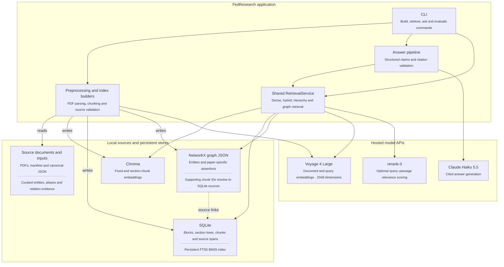
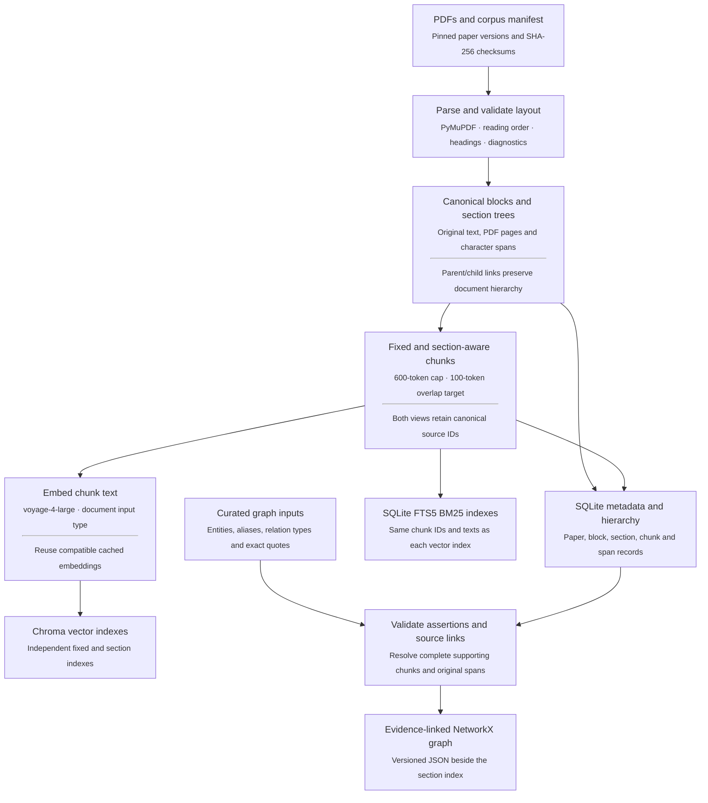
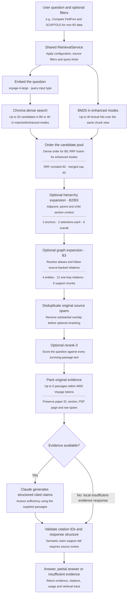

# FedResearch

**A structure-aware RAG assistant for federated-learning research papers.** It retrieves original passages from 40 papers, answers through Claude and cites the paper, section and PDF page.

Implementation and final evaluation are complete. Delivery verification is complete (2026-10-26). The frozen comparison contains nine modes / 135 successful question executions, with a separate assistant source audit. See [final results](reports/final_evaluation.md), [examples](reports/examples.md) and [delivery checks](reports/delivery.md).

The research question is whether document structure improves evidence retrieval over a conventional chunk-based baseline. Hybrid search plus reranking has the strongest gold-span coverage on this benchmark. Section chunks help some questions; bounded hierarchy and graph expansion have mixed effects. These are small, source-span comparisons with non-blind assistant review, rather than independent human accuracy measurements.

## 1. Install and run

Run commands from the project root. The tested environment is **macOS arm64, Python 3.13.1 and uv 0.11.24**; `pyproject.toml` declares Python 3.11–3.13, but other Python/platform combinations have not been delivery-tested. Install [uv](https://docs.astral.sh/uv/getting-started/installation/) and use the locked dependencies.

```bash
uv sync --locked
cp -n .env.example .env
# Edit .env locally: set ANTHROPIC_API_KEY and VOYAGE_API_KEY.
uv run fedresearch doctor
```

Generation uses `claude-haiku-5-5` through the Anthropic SDK. Embeddings use `voyage-4-large` at 2,048 dimensions; optional reranking uses `rerank-3` through the Voyage SDK and the same `VOYAGE_API_KEY`. Atlas keys route through the SDK. Claude does not supply embeddings. Keep credentials in the ignored `.env` or environment, separate from source and example outputs. `doctor` reports key presence, without model calls; `doctor --live` makes small embedding, reranking and generation calls even when ordinary reranking is disabled.

### Acquire, parse and build

The seven-field [manifest](data/corpus_manifest.jsonl) pins all paper versions and PDF checksums. The standalone helper downloads the PDFs into ignored `data/raw/`; it reuses matching files, rejects changed bytes and reports the exact source for manual download if access is blocked. It never edits the manifest. There are no corpus-download commands in the application CLI.

```bash
uv run python scripts/download_corpus.py
# If PDFs are already present, verify them without downloads:
uv run python scripts/download_corpus.py --check-only

HF_HOME=work/hf-cache uv run fedresearch preprocess
uv run fedresearch benchmark validate
# Embeds fixed chunks; also builds persistent BM25 and SQLite provenance:
HF_HOME=work/hf-cache uv run fedresearch index
# Embeds section chunks in a separate index:
HF_HOME=work/hf-cache uv run fedresearch index --config configs/experiments/b2a_section.yaml
# Local graph build using the section index and reviewed source assertions:
HF_HOME=work/hf-cache uv run fedresearch graph-build --config configs/experiments/b3_graph.yaml
```

The official tokenizer `voyageai/voyage-4-large` is pinned to revision `bb931c2635a93efe400c24741363d8ff61d7bb32`. Its approximately 7 MB tokenizer file downloads once from Hugging Face; no model weights are needed. `HF_HOME=work/hf-cache` sets the local Hugging Face cache directory for that command. It does not choose the embedding model or send data to a provider. After caching, `HF_HUB_OFFLINE=1` permits local-only tokenizer loading. BM25 uses SQLite's word tokenizer separately.

Preprocessing and graph building run locally. Indexing calls Voyage for uncached document embeddings; completed compatible indexes and successful embedding batches are reused. The measured full builds used 683,346 embedding tokens for fixed chunks and 636,094 for section chunks; rebuilding both from an empty cache repeats that workload. Current benchmark labels are already frozen and source-verified. An unchanged rebuild validates them without running `benchmark freeze` again.

### Ask and inspect evidence

```bash
# Default: dense-20, with reranking off.
HF_HOME=work/hf-cache uv run fedresearch ask "What four properties distinguish federated optimization in the FedAvg paper?" --paper-id fedavg
# Explicit hybrid plus reranking; the default is unchanged.
HF_HOME=work/hf-cache uv run fedresearch ask "How do pFedMe and FedMD address different forms of client heterogeneity?" --config configs/experiments/b1_hybrid_rerank.yaml --json
# Inspect selected passages, component rankings and expansion reasons:
HF_HOME=work/hf-cache uv run fedresearch retrieve "How does SCAFFOLD correct client drift?" --config configs/experiments/b3_graph.yaml
```

`[E1]` citations resolve to original paper/version, section paths, **1-based PDF pages** and raw block spans. `ask --json` includes the answer, evidence, usage and retrieval trace. All selected evidence is sent to Claude, whether or not the answer cites every passage. Code checks IDs/provenance and structured response validity; semantic support still requires source review. Partial or insufficient answers explicitly describe evidence limits. More [saved examples](reports/examples.md) require no model calls to inspect.

| Command | Purpose | Network/model use |
| --- | --- | --- |
| `doctor` | Validate settings and key presence | None; `--live` calls embedding, reranking and generation |
| `preprocess` | Parse PDFs, detect sections, create fixed chunks and diagnostics | First tokenizer download only |
| `index` | Build/reuse Chroma, SQLite and BM25 | Uncached document embeddings |
| `graph-build` | Validate curated assertions and save graph | None |
| `retrieve` | Return selected source evidence and trace | Query embedding; optional reranking |
| `ask` | Retrieve and generate a cited answer | Query embedding, optional reranking, Claude |
| `benchmark validate` | Verify original-source annotations | None |
| `benchmark freeze` | Record a verified test-label hash during benchmark construction | None; current labels are already frozen |
| `evaluate` | Run a split and save evidence, scores, usage and optional answers | Queries/reranking; Claude with `--with-answers`; replay skips upstream stages |

## 2. Retrieval and configuration

**Mental model:** find candidates → optionally promote original passages through hierarchy/graph links → remove overlapping source text → optionally rerank → pack up to five passages → generate cited claims. One shared service handles questions and evaluation.

### Architecture: components and their dependencies

This view shows the application, persistent stores and hosted models. Arrows mean “uses” or the labeled read/write dependency; execution order is shown separately below.



### Offline flow: prepare documents and build indexes

The build starts from pinned PDFs. Canonical blocks retain original evidence, while fixed and section-aware chunks provide two index views. The graph uses reviewed assertions and complete source links; graph building makes no model calls. The branches below show data dependencies rather than an exact file-write schedule.



### Online flow: collect evidence and answer

Configuration selects the stages in this fixed workflow. Dense search runs in every fresh retrieval; enhanced modes add BM25/RRF. B2/B3 add hierarchy expansion and B3 adds graph support before shared evidence selection. Evaluation replays can reuse saved upstream pools, as described in the evaluation section.



Disabled optional stages pass the candidate pool through unchanged. Source provenance is checked during parsing/indexing and retained throughout retrieval; citation validation checks the returned IDs and response consistency, rather than automatically proving semantic support. There is no agent planning loop in this implementation.

### Retrieval configurations and budgets

| Mode/config in `configs/experiments/` | Candidate selection | Index |
| --- | --- | --- |
| B0 `b0_dense.yaml` | Up to 20 dense hits | Fixed |
| B0-R `b0_dense_rerank.yaml` | Same dense settings, then rerank | Fixed |
| B0-40 `b0_dense_40.yaml` | Up to 40 dense hits | Fixed |
| B1 `b1_hybrid.yaml` | Dense 40 + BM25 40 → RRF, cap 40 | Fixed |
| B1-R `b1_hybrid_rerank.yaml` | Same hybrid settings, then rerank | Fixed |
| B2a `b2a_section.yaml` | Same hybrid search over section chunks | Section |
| B2 `b2_structure.yaml` | B2a search plus bounded hierarchy | Section |
| B3 `b3_graph.yaml` | B2 plus source-backed graph support | Section |
| B3-R `b3_graph_rerank.yaml` | B3 plus reranking | Section |

RRF sums `1/(60+rank)` across dense/lexical lists; it combines ranks rather than unlike score scales. SQLite FTS5 persists BM25 in `artifacts/indexes/<index-id>/bm25.sqlite`, using `unicode61 remove_diacritics 0` and built-in `k1=1.2`, `b=0.75`. Query words are quoted and OR-connected. There is no stemming, title boosting or synonym expansion. Lexical statistics apply corpus-wide; filters apply before result caps.

Hierarchy considers three anchors, two neighbor selections each and six overall. Local BM25 chooses adjacent/parent/child passages within a bounded neighborhood; the trace records real sources, reasons, promotions/additions and dropped seeds. Graph traversal matches whole aliases longest-first, at most four query entities and 12 one-hop relations, selecting at most six supporting chunks. Both preserve the merged cap of 40, so promotions can displace useful sources.

Shared deduplication removes a later candidate if its original spans overlap at least 50% of the smaller span set. `rerank-3` receives the question and every surviving candidate's **text**, then returns input indices and relevance scores. It receives neither embeddings nor dense scores; local code maps returned indices to chunk IDs. All returned rankings remain inspectable, and final packing selects up to five chunks within 4,000 **Voyage passage-text tokens**. That budget excludes prompt formatting and is separate from Claude/provider billing tokens. Truncation is disabled; provider failures remain failures.

Experiment YAML fields merge with `configs/default.yaml`, overriding conflicts within each section. No `extends` mechanism is used. Relative paths resolve from the project root. `FEDRESEARCH_GENERATION_MODEL` and `FEDRESEARCH_EMBEDDING_MODEL` override model names in YAML; dimensions/budgets remain YAML settings. A changed embedding identity or corpus/parser configuration requires a compatible rebuild. Search is corpus-wide unless explicit filters are supplied; automatic routing and query rewriting are disabled. Query vectors exist only in memory; runs save candidate IDs/ranks/scores and embedding usage rather than query vectors.

## 3. Corpus, provenance and scope

The 40 pinned English research PDFs cover methods, heterogeneity, personalization, fairness, surveys, privacy/attacks, communication, systems and applications. This is a curated sample, not an exhaustive literature review. The current parse contains **937 pages, 47,592 blocks and 955 sections**, with **1,158 fixed chunks** and **1,514 section chunks** in independent indexes. Both chunk policies use a 600-Voyage-token cap and a 100-token overlap target. Section chunks stay within sections; fixed chunks may cross section/page boundaries. All supporting section paths/pages are retained.

The manifest stores exactly `paper_id`, `title`, `year`, `source_url`, `document_version`, `sha256` and `methods`. Preprints use pinned arXiv versions and citation/submission years; the two published-only copies use DOI identities and publication years. Sources are in the manifest; paper PDFs are acquired separately rather than redistributed in Git.

PyMuPDF v4 parsing corrects common two-column reading order and detects numbered/Roman headings, with explicit fallback sections. Original text and bounding boxes remain in canonical blocks. Cleaned text maps back to **half-open Unicode character offsets** in those blocks, enabling stable gold evidence across chunk policies. A parse/chunk identity depends on source/configuration/text; a run ID is a random UUID. Detected table cells, equation-like fragments, references and margins are excluded from chunks while original blocks remain available. Representative visual checks and actual parser corrections are in [preprocessing verification](reports/preprocessing.md). Zero diagnostics warnings do not establish perfect extraction; OCR, chart pixels and reliable numeric-table/equation reasoning are outside the implemented scope.

### BookRAG adaptation and graph

FedResearch adapts document trees, an entity graph and evidence links to a multi-paper corpus, adding dense/BM25 search. It is **BookRAG-inspired**. Query classification, richer retrieval operators, graph-based scoring, Skyline selection and gradient-based entity resolution are unimplemented research extensions. The original paper's reranking/entity-resolution methods are research references rather than reproduced algorithms. See [BookRAG](https://arxiv.org/abs/2512.03413) and its [author repository](https://github.com/sam234990/BookRAG).

The assistant-curated [graph inputs](data/graph_curated.json) contain 36 entities and 29 assertions from 14 papers, using `uses`, `addresses` and `evaluated_on` relations. Method/technique/problem/dataset entities have explicit aliases. Every assertion carries an exact quote, paper version and original span. SQLite resolves complete containing chunks; graph JSON retains those source links, section/page identities and input/index hashes. Co-occurrence alone does not establish a relation. The other 26 papers remain searchable. Curation is non-blind and narrow; no automatic extraction or independent human review is claimed.

No agent/MCP wrapper, UI, video or course-rubric deliverable is included. The application uses direct SDKs and a fixed retrieval-and-answer pipeline; it does not require an orchestration framework.

### Storage and future alternatives

| Data | Implemented storage | Possible shared-service alternative |
| --- | --- | --- |
| Blocks, sections, chunks and graph-to-source links | SQLite `metadata.sqlite`, including `chunk_spans` | PostgreSQL with stable IDs and recursive hierarchy queries |
| Dense embeddings | Persistent Chroma | A managed vector store if scale/concurrency requires it |
| Word index | SQLite FTS5 `bm25.sqlite` | Elasticsearch, with its analyzer/ranking evaluated separately |
| Knowledge graph | Versioned directed NetworkX multigraph JSON | Neo4j with driver/import/traversal code |

NetworkX JSON can be mapped into Neo4j nodes and typed relationships by stable IDs, retaining direction, assertion identity and evidence. It is not a native Neo4j import format: a Python/Cypher mapping is required; APOC graph import expects its own export format. Nested attributes may need flattening or evidence nodes. Docker starts Neo4j, but application driver/configuration, import/constraints and bounded queries would still be needed. The implemented small-corpus store remains NetworkX; no dual-store adapter is maintained.

## 4. Evaluation and reproduction

There are five dev and fifteen test questions, with thirteen answerable test questions and two unsupported premises. Labels were selected from canonical sources independently of retrieval. Required evidence groups contain alternative original block spans/quotes; comparisons may require multiple papers. Labels stay out of the generation prompt.

`benchmark freeze` records SHA-256 over the entire `data/benchmarks/test.jsonl`, annotation statuses and human-review status in `frozen.json`. Evaluation rejects any byte mismatch. This is an integrity check, not a file lock or training procedure. The current labels are `source_verified`, with `human_review_complete: false`. Preserve them during evaluation; changing labels and refreezing to improve observed scores is invalid.

### Final frozen-test results

| Arm | Gold-span precision@5 | Group recall@5 | Complete final coverage |
| --- | ---: | ---: | ---: |
| B0 | 0.1077 | 0.4103 | 5/13 |
| B0-R | 0.2154 | 0.8077 | 10/13 |
| B0-40 | 0.1077 | 0.4103 | 5/13 |
| B1 | 0.1692 | 0.7308 | 9/13 |
| B1-R | 0.2308 | 0.8846 | 11/13 |
| B2a | 0.1692 | 0.7692 | 9/13 |
| B2 | 0.1692 | 0.6923 | 8/13 |
| B3 | 0.2308 | 0.8590 | 10/13 |
| B3-R | 0.2000 | 0.8462 | 10/13 |

Precision counts matching evidence items / 5. A group is covered if **one** item covers at least 50% of an alternative gold passage's raw character span in the same block; overlapping spans within that item are unioned, but separate subthreshold items are not combined. Group recall is covered groups / required groups; complete coverage requires all groups. These are macro means over thirteen positives; negatives have null positive-evidence scores. Candidate coverage uses the same source-span rule before final selection.

Both negatives abstain in all nine arms (18/18 answers); no answerable query fully abstains. All 135 executions succeed. The [assistant audit](reports/final_answer_audit.json) reviews 279 structured claims and 517 citation pairs against supplied passages, with correctness/relevance on 0–2 scales and traceable reasons. Strict whole-claim citation support distinguishes complementary partial citations from unsupported sources. These are assistant judgments; independent human grading and prose-wide hallucination rates remain unmeasured.

B1-R has the strongest annotated retrieval here. Section chunks modestly improve recall over B1; hierarchy regresses; graph recovers some sources but also displaces useful evidence. Graph-pool reranking restores test08 while harming test11/test13. Missing original FedAvg/AFL evidence leaves comparisons incomplete. The [final report](reports/final_evaluation.md) contains every arm, paired rank changes, answer-audit counts, usage and actual limitations. Sparse labels, prior test exposure, non-blind graph curation and small sample size limit generalization. Defaults remain dense-20 with reranking off; no test-driven tuning was performed. Historical development reports remain separate and identify results whose raw runs were pruned during delivery.

### Inspect saved results without model calls

```bash
uv run python scripts/verify_delivery.py
# Restore the nine original run files from the delivered archive if absent:
uv run python -m zipfile -e reports/final_runs.zip artifacts/runs
```

`reports/final_runs.zip` contains only the nine final test runs, including reused B0/B0-R controls. The summary maps arms to original run IDs/hashes; `final_runs.sha256` checks the archive bytes. The verifier recomputes final span scores, checks the frozen inputs/run bytes and source-audit arithmetic, without APIs or rebuilt indexes. It checks the recorded assistant judgments' arithmetic, not their semantics. Local `artifacts/runs/` was pruned to these nine runs; future `ask`/`evaluate` commands naturally create new runs there.

### Reproduce a controlled comparison

```bash
HF_HOME=work/hf-cache uv run fedresearch evaluate --config configs/experiments/b1_hybrid.yaml --split dev --with-answers
# Replace NEW_B1_RUN_ID with the ID printed above:
HF_HOME=work/hf-cache uv run fedresearch evaluate --config configs/experiments/b1_hybrid_rerank.yaml --split dev --with-answers --candidate-source artifacts/runs/NEW_B1_RUN_ID/run.json
```

Test reproduction uses `--split test` with the frozen labels and newly generated test source runs. B0/B0-R, B1/B1-R and B3/B3-R use `--candidate-source` to hold final pools fixed for reranking; it preserves component/expansion traces and skips upstream retrieval/expansion. B2a→B2 and B2→B3 use `--seed-source` to hold upstream pools fixed while executing the new expansion stage. The two flags are mutually exclusive. Use matching splits and new source IDs in sequence; exact stage order and all preserved IDs are in [the final report](reports/final_evaluation.md).

Fresh evaluations make hosted calls and produce new answers/IDs; they need not reproduce provider outputs byte-for-byte. Replay timings omit upstream work and are not full-pipeline speed measurements. Pricing estimates stay null unless nominal per-million-token prices from `.env.example` are configured; they do not include free credits or discounts. The original 2026-10-15 provider-pricing note is historical, not a current account balance or price guarantee.

## 5. Python file guide

This describes the files that exist now. Each Python module and function has a docstring. Small supporting functions start with `Helper to ...:`; the main pipeline functions describe the operation they perform. Paths in this table are relative to `src/fedresearch/`.

| Python file | What it does | Why it is needed |
| --- | --- | --- |
| [`cli.py`](src/fedresearch/cli.py) | Defines commands and prints their results | Provides one entry point while keeping the actual work in services |
| [`settings.py`](src/fedresearch/settings.py) | Loads YAML, experiment overrides and environment settings | Keeps model choices and budgets consistent across runs |
| [`tokenization.py`](src/fedresearch/tokenization.py) | Loads and caches the pinned official Voyage tokenizer locally | Gives chunking, evidence counts and query limits one consistent token definition |
| [`graph.py`](src/fedresearch/graph.py) | Defines curated entities/relations, validates source quotes and saves/loads NetworkX JSON | Keeps graph assertions versioned and tied to complete original evidence |
| [`schemas.py`](src/fedresearch/schemas.py) | Defines papers, blocks, chunks, evidence and answers | Preserves typed source identities and citation contracts |
| [`util.py`](src/fedresearch/util.py) | Hashes identities/files and reads/writes JSON | Shares the few persistence helpers used by several stages |
| [`corpus/manifest.py`](src/fedresearch/corpus/manifest.py) | Reads metadata and checks the existing local PDFs | Pins the exact papers/versions being processed |
| [`preprocessing/pdf_parser.py`](src/fedresearch/preprocessing/pdf_parser.py) | Extracts text/layout, fixes column order and records diagnostics | Turns PDFs into canonical evidence with page coordinates |
| [`preprocessing/cleaning.py`](src/fedresearch/preprocessing/cleaning.py) | Cleans whitespace/hyphenation with a raw-offset map | Lets cleaned chunks still cite the original extracted text |
| [`preprocessing/sections.py`](src/fedresearch/preprocessing/sections.py) | Detects headings and assigns section/parent links | Provides section citations and the hierarchy used in later retrieval |
| [`preprocessing/chunking.py`](src/fedresearch/preprocessing/chunking.py) | Creates fixed or section-bounded windows using the same tokenizer/source spans | Compares chunk policies while preserving canonical source IDs |
| [`preprocessing/validation.py`](src/fedresearch/preprocessing/validation.py) | Checks source mappings, page ranges and serious warnings | Prevents invalid parses from silently entering an index |
| [`indexing/pipeline.py`](src/fedresearch/indexing/pipeline.py) | Runs preprocessing/index builds and validates saved versions | Coordinates stages and activates only complete compatible indexes |
| [`indexing/embeddings.py`](src/fedresearch/indexing/embeddings.py) | Caches vectors and embeds missing chunks in batches | Avoids repeating successful API calls after a rebuild/interruption |
| [`indexing/vector_index.py`](src/fedresearch/indexing/vector_index.py) | Stores/searches vectors in persistent Chroma | Supplies dense candidate retrieval and metadata filters |
| [`indexing/lexical_index.py`](src/fedresearch/indexing/lexical_index.py) | Builds/searches a persistent SQLite FTS5 BM25 index over the same chunks | Adds word matching without another dependency or model call |
| [`storage/metadata_store.py`](src/fedresearch/storage/metadata_store.py) | Stores paper/section/block/chunk records in SQLite | Resolves vector hits and citations back to original sources |
| [`retrieval/service.py`](src/fedresearch/retrieval/service.py) | Applies filters, retrieves, deduplicates, optionally reranks and packs evidence | Gives answers and evaluation one retrieval implementation |
| [`retrieval/evidence.py`](src/fedresearch/retrieval/evidence.py) | Removes source overlap and constructs evidence under the final budget | Prevents duplicate passages and retains citation-ready provenance |
| [`retrieval/fusion.py`](src/fedresearch/retrieval/fusion.py) | Combines dense/BM25 ranks with RRF and stable ties | Merges searches without mixing their different score scales |
| [`retrieval/hierarchy.py`](src/fedresearch/retrieval/hierarchy.py) | Selects bounded adjacent/parent/child context and records its source/reason | Tests section navigation independently of chunking and reranking |
| [`retrieval/graph.py`](src/fedresearch/retrieval/graph.py) | Resolves query aliases, follows one-hop relations and merges bounded support chunks | Tests graph navigation while sending original source text to the answer model |
| [`retrieval/reranking.py`](src/fedresearch/retrieval/reranking.py) | Calls Atlas `rerank-3` and returns validated indices/scores/usage | Adds optional query-passage ranking without changing source text |
| [`llm/client.py`](src/fedresearch/llm/client.py) | Wraps the official Claude/Voyage SDKs and records usage | Isolates provider requests, vector checks and sanitized errors |
| [`llm/answering.py`](src/fedresearch/llm/answering.py) | Retrieves evidence, generates structured claims and validates citations | Produces grounded answers through one fixed pipeline |
| [`evaluation/dataset.py`](src/fedresearch/evaluation/dataset.py) | Loads question labels, verifies source quotes and enforces the held-out freeze | Keeps benchmark labels independent of chunking/retrieval |
| [`evaluation/retrieval_metrics.py`](src/fedresearch/evaluation/retrieval_metrics.py) | Computes span-based precision/recall/coverage diagnostics | Measures retrieval against the same original evidence across experiments |
| [`evaluation/runner.py`](src/fedresearch/evaluation/runner.py) | Runs questions, optionally replays saved dense/hybrid pools, and saves candidate/final metrics, answers, timing and failures | Makes comparisons inspectable and isolates reranking effects |
| `__init__.py` files in each package | Mark Python packages; the root also defines the version | Support package imports; they contain no pipeline logic |

The answer prompt lives in `src/fedresearch/llm/prompts/answer.md`. Settings live in `configs/default.yaml`. B0/B0-R retain their original 20-candidate settings. `b1_hybrid.yaml` and `b1_hybrid_rerank.yaml` select hybrid retrieval with a 40-candidate cap; `b0_dense_40.yaml` provides a matching dense control. `b2a_section.yaml` uses section chunks without expansion; `b2_structure.yaml` adds bounded hierarchy expansion over the same index. Graph retrieval uses `graph.py`, `retrieval/graph.py`, curated source data and `b3_graph.yaml`/`b3_graph_rerank.yaml`.

Tests are separate from application code:

| Test file | Purpose |
| --- | --- |
| `tests/test_pipeline.py` | Generated-PDF integration checks for parsing/provenance, index persistence, filters, cache, reranking and citations |
| `tests/test_embeddings_api.py` | Voyage embedding request/response handling, document/query roles and vector validation |
| `tests/test_generation_api.py` | Claude structured responses, truncation/refusal handling and sanitized errors |
| `tests/test_reranking_api.py` | Atlas rerank-3 request/response handling, index validation and empty-scope behavior |
| `tests/test_settings.py` | Default/experiment YAML merging and path resolution |
| `tests/test_hybrid.py` | BM25 persistence, exact terms, safe queries, filters and deterministic RRF arithmetic |
| `tests/test_structure.py` | Section source coverage, token limits, heading-only exclusion and bounded parent/child/adjacent navigation |
| `tests/test_graph.py` | Source assertion validation, graph reload/tampering, alias overlap, bounded scopes and exact graph/reranking replays |
| `tests/test_delivery.py` | Exact-byte corpus acquisition/reuse, changed-file rejection and incomplete-download cleanup |
| `tests/test_tokenization.py` | Voyage chunk limits, Unicode coverage, exact source spans and no silent tokenizer truncation/padding |

For a quick review, start with `cli.py` → `llm/answering.py` → `retrieval/service.py` → `retrieval/evidence.py`. Read `retrieval/reranking.py` for the optional ranking stage. `indexing/pipeline.py` is the build path; the PDF layout details are isolated under `preprocessing/`.

## 6. Artifacts and verification

| Location | Contents / lifecycle |
| --- | --- |
| `src/fedresearch/` | Application and packaged answer prompt |
| `configs/` | Default settings and explicit experiment overrides |
| `data/corpus_manifest.jsonl` | Pinned source identities; tracked |
| `data/graph_curated.json`, `data/benchmarks/` | Reviewed graph inputs and source-verified/frozen annotations; tracked |
| `data/raw/`, `data/processed/` | Acquired PDFs and generated canonical parses; ignored |
| `artifacts/indexes/<index-id>/` | SQLite source/BM25 records, Chroma, index manifest and optional graph; ignored |
| `artifacts/indexes/CURRENT.json`, `CURRENT_section.json` | Independent active fixed/section pointers, selected only after successful builds |
| `artifacts/indexes/embedding_cache.sqlite` | Successful document embeddings reused by compatible builds; ignored |
| `artifacts/runs/<run-id>/` | Local answers/evaluations; ignored; nine selected tests also delivered in the report archive |
| `reports/` | Final comparison/audit, selected-run archive, examples, delivery record and labeled historical reports |
| `scripts/` | Two small standalone acquisition/integrity helpers; no extra Typer commands |
| `work/` | Local caches and temporary verification work; not a required setup input |

```bash
HF_HOME=work/hf-cache uv run pytest -q
uv run ruff check src tests scripts
uv run ruff format --check src tests scripts
uv run python scripts/verify_delivery.py
uv run fedresearch benchmark validate
```

Tests use controlled provider doubles and generated PDFs to verify consequential behavior; they are not hosted quality measurements. Delivery also checks a built wheel in a separate locked environment, packaged prompt access and an isolated real-provider small-corpus workflow. Exact results and remaining environment/access limitations are in [delivery verification](reports/delivery.md). PyMuPDF emits existing upstream SWIG deprecation warnings under Python 3.13.

Changing a source/model/tokenizer/parser can invalidate dependent artifacts. Preserve pinned inputs for reproduction; if intentionally changing them later, reparse/rebuild and verify source annotations in a new experiment rather than silently rewriting the frozen comparison. The historical tokenizer migration changed only parse/block IDs after checking all 26 source passages against unchanged text/pages/coordinates/quotes/offsets. It is complete and is not a quickstart step.

Useful troubleshooting:

- Missing/changed PDF: acquire the exact manifest version and verify its hash; never silently accept a different file.
- Missing tokenizer cache: allow its one-time public download before using `HF_HUB_OFFLINE=1`. No HF token is required for the cached local workflow.
- Index identity mismatch: restore the matching model/corpus/config or build a separate compatible index.
- Rate limit/provider failure: inspect the sanitized error and retry within account limits. No successful substitute is fabricated. Cached document batches can reduce repeat work.
- Weak/incomplete answer: inspect candidate and final evidence in the trace. More initial candidates cannot ensure that the final five contain every required fact, and reranking cannot recover a source absent from its input pool.

## 7. References and project status

Research sources are pinned in the corpus manifest and cited by answers. Primary implementation references: [Claude structured outputs](https://platform.claude.com/docs/en/build-with-claude/structured-outputs), [Voyage embeddings](https://docs.voyageai.com/docs/embeddings), [Voyage tokenization](https://www.mongodb.com/docs/voyageai/tutorials/tokenization/), [Atlas rerankers](https://www.mongodb.com/docs/voyageai/models/rerankers/?client=python), [PyMuPDF text extraction](https://pymupdf.readthedocs.io/en/latest/recipes-text.html), [Chroma](https://docs.trychroma.com/), [SQLite FTS5](https://sqlite.org/fts5.html), [NetworkX node-link JSON](https://networkx.org/documentation/stable/reference/readwrite/generated/networkx.readwrite.json_graph.node_link_data.html), [Neo4j driver](https://neo4j.com/docs/python-manual/current/query-simple/) and [APOC JSON loading](https://neo4j.com/docs/apoc/current/import/load-json/). The linked BookRAG paper/repository describe the broader research design; this project preserves the narrower implemented scope above.

Phases 0–5 and final evaluation are complete. The [implementation plan](IMPLEMENTATION_PLAN.md) records their gates; the [phase status](reports/phase_status.md) records current completion. Delivery is complete, with 84 passing tests and an isolated live workflow. The former temporary `docs/` notes were consolidated here and in the reports and the folder removed. Historical results are preserved as reports; optional agent/MCP, full BookRAG algorithms, Neo4j and UI work remain outside this delivery.
