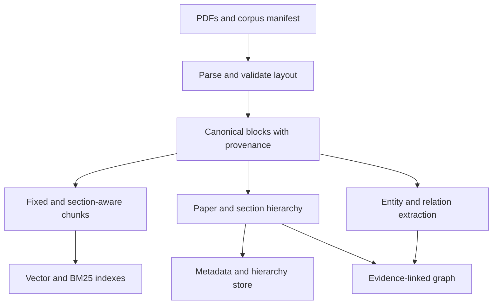
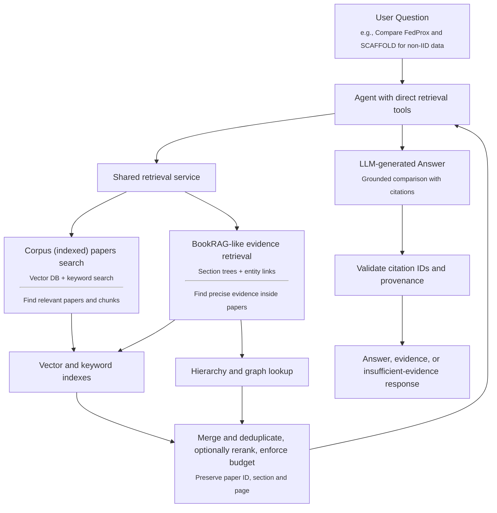

# FedResearch

**A structure-aware, agentic RAG assistant for federated-learning research papers.**

Status: **Phases 0–4 complete; section chunking helps dev retrieval, hierarchy expansion remains experimental** (2026-10-23). The 40-paper corpus retains its 1,158 fixed chunks and now has a separate index of 1,514 section chunks with unchanged canonical source IDs. All 67 offline tests pass. See [baseline results](reports/evaluation.md), [hybrid results](reports/hybrid_development.md), [structure report](reports/structure.md) and [phase status](reports/phase_status.md).

FedResearch will answer technical questions using a curated PDF corpus, retrieve supporting passages, and cite the paper, section, and PDF page. It will combine corpus-level search with document hierarchy and a small evidence-linked knowledge graph inspired by BookRAG.

## 1. Project goal

Build and evaluate a research assistant that can:

- Explain a method using passages from its original paper.
- Connect a method's description, assumptions, and experimental evaluation across sections.
- Compare methods across papers, with evidence from each paper.
- Summarize approaches represented in the indexed corpus.
- State when the corpus does not contain sufficient evidence.

Example questions:

1. How does SCAFFOLD address client drift, and where is its effectiveness evaluated?
2. How do FedProx and SCAFFOLD differ in their treatment of statistical heterogeneity?
3. Which approaches in this corpus address non-IID client data, and what limitations do their authors describe?

These examples become benchmark questions only after their answerability and source passages have been checked against the selected PDFs.

**Research question:** Does preserving document structure improve evidence retrieval and grounded question answering over federated-learning papers, compared with conventional chunk-based RAG?

**Secondary question:** Does a small knowledge graph improve cross-section and cross-paper evidence coverage beyond hybrid, structure-aware retrieval?

Improvement is a hypothesis to test. An honest negative result is a valid project outcome.

## 2. Agreed project scope

Build a simple, grounded federated-learning research assistant and measure whether hybrid and BookRAG-inspired structure improve evidence retrieval and answer relevance. The user's agreed scope replaces the earlier course checklist. There is no assignment-rubric gate, video deliverable, mandatory deadline, MCP implementation, or quota of failure cases.

| Area | Deliverable |
| --- | --- |
| Corpus | 40 papers: preserve the existing 20 and add 20 selected papers covering surveys, privacy, systems and applications |
| Baseline | Fixed-size chunks, dense retrieval, original-source cited answers |
| Enhanced retrieval | BM25 plus dense search with RRF; section-aware chunks and bounded hierarchy expansion |
| Graph | A small evidence-linked graph where entity navigation demonstrably helps |
| Agent | Bounded direct function/tool calls to the shared retrieval service |
| Models | Claude Haiku 5.5 generation; Voyage 4 Large embeddings at 2048 dimensions |
| Evaluation | 20 annotated questions: 5 development / 15 held-out; at least 10 useful comparison questions |
| Documentation | Actual setup, architecture, measured results, limitations and any observed failures |
| Optional future extension | An MCP wrapper for external clients; outside this project's implementation scope |

Initial scope: English, text-based research PDFs; reliable prose and source citations. Tables enter only when their headers, cells, and context can be extracted faithfully. Unreliable tables are flagged. Equation interpretation, chart-image reasoning, OCR-heavy documents, exhaustive literature reviews, and a complete BookRAG reproduction remain extensions.

Keep the same corpus, parser, embedding model, generator, test questions and evidence budget for controlled comparisons. Use the graph and agent only when their measured benefit justifies their complexity. Document failures that occur in real runs; never introduce failures to satisfy a reporting count. Negative questions evaluate successful abstention when the corpus lacks evidence.

The original 20 papers cover methods, optimization/heterogeneity, personalization and fairness. The selected additions broaden communication efficiency, secure aggregation, privacy attacks, systems, surveys and applications. The 40-paper corpus must be fixed before comparing retrieval modes; historical 20-paper results are a separate corpus version.

## 3. Relationship to BookRAG

BookRAG introduces a BookIndex containing a document hierarchy, an entity graph, and mappings from entities to hierarchy nodes, together with an agent-based retrieval workflow. FedResearch adapts these ideas to a collection of independent research papers, adding a corpus-level search layer.

This is a **BookRAG-inspired implementation**, not a reproduction or a claim to reproduce its benchmark results. We will implement our own pipeline and cite the paper and any code consulted.

At the architectural level, BookRAG’s central index contains:

- A document tree.
- An entity–relation graph.
- Links connecting graph entities to document nodes.

Our planned **section trees**, **knowledge graph**, and **evidence links** reproduce that central idea. However, the original also specifies **query classification**, **retrieval operators**, **graph-based scoring**, **Skyline selection**, and **gradient-based entity resolution**. We are simplifying those algorithms and adding BM25/vector search across papers.

The original BookRAG also uses reranking: its text-ranking operator scores retrieved blocks for query relevance, while Skyline selection combines text relevance with graph importance. Appendix A.2 specifies Qwen3-Reranker-4B for its experiments. Reranking also supports entity resolution during indexing. Our initial adaptation uses a configurable query-time relevance reranker; reproducing Skyline selection or model-based entity resolution is outside the minimum scope.

References: [BookRAG paper](https://arxiv.org/abs/2512.03413), [author repository linked in our earlier discussion](https://github.com/sam234990/BookRAG). Repository availability and implementation details should be checked before relying on its code.

## 4. Architecture

### Offline: prepare documents and build indexes



### Online: collect evidence and answer



The agent calls the shared retrieval service through direct function tools. The fixed baseline and evaluation code use the same service, so retrieval algorithms can be evaluated independently of agent behavior. MCP is not required and will not be implemented for this project; an external-client wrapper is a possible future extension.

Baseline retrieval searches chunks across all papers unless the caller supplies a filter. Paper metadata is limited to fields used for citations, version checks and filtering. Optional later paper discovery can use titles and method names; generated summaries and graph labels would only guide navigation, with citations resolving to original source blocks.

## 5. Python file guide

This describes the files that exist now. Each Python module and function has a docstring. Small supporting functions start with `Helper to ...:`; the main pipeline functions describe the operation they perform. Paths in this table are relative to `src/fedresearch/`.

| Python file | What it does | Why it is needed |
| --- | --- | --- |
| [`cli.py`](src/fedresearch/cli.py) | Defines commands and prints their results | Provides one entry point while keeping the actual work in services |
| [`settings.py`](src/fedresearch/settings.py) | Loads YAML, experiment overrides and environment settings | Keeps model choices and budgets consistent across runs |
| [`tokenization.py`](src/fedresearch/tokenization.py) | Loads and caches the pinned official Voyage tokenizer locally | Gives chunking, evidence counts and query limits one consistent token definition |
| [`schemas.py`](src/fedresearch/schemas.py) | Defines papers, blocks, chunks, evidence and answers | Preserves typed source identities and citation contracts |
| [`util.py`](src/fedresearch/util.py) | Hashes identities/files and reads/writes JSON | Shares the few persistence helpers used by several stages |
| [`corpus/manifest.py`](src/fedresearch/corpus/manifest.py) | Reads metadata and checks the existing local PDFs | Pins the exact papers/versions being processed |
| [`preprocessing/pdf_parser.py`](src/fedresearch/preprocessing/pdf_parser.py) | Extracts text/layout, fixes column order and records diagnostics | Turns PDFs into canonical evidence with page coordinates |
| [`preprocessing/cleaning.py`](src/fedresearch/preprocessing/cleaning.py) | Cleans whitespace/hyphenation with a raw-offset map | Lets cleaned chunks still cite the original extracted text |
| [`preprocessing/sections.py`](src/fedresearch/preprocessing/sections.py) | Detects headings and assigns section/parent links | Provides section citations and the hierarchy used in later retrieval |
| [`preprocessing/chunking.py`](src/fedresearch/preprocessing/chunking.py) | Creates fixed or section-bounded windows using the same tokenizer/source spans | Compares chunk policies while preserving canonical source IDs |
| [`preprocessing/validation.py`](src/fedresearch/preprocessing/validation.py) | Checks source mappings, page ranges and serious warnings | Prevents invalid parses from silently entering an index |
| [`indexing/pipeline.py`](src/fedresearch/indexing/pipeline.py) | Runs preprocessing/index builds and validates saved versions | Coordinates stages and activates only complete compatible indexes |
| [`indexing/embeddings.py`](src/fedresearch/indexing/embeddings.py) | Caches vectors and embeds missing chunks in batches | Avoids repeating successful API calls after a rebuild/interruption |
| [`indexing/vector_index.py`](src/fedresearch/indexing/vector_index.py) | Stores/searches vectors in persistent Chroma | Supplies dense candidate retrieval and metadata filters |
| [`indexing/lexical_index.py`](src/fedresearch/indexing/lexical_index.py) | Builds/searches a persistent SQLite FTS5 BM25 index over the same chunks | Adds word matching without another dependency or model call |
| [`storage/metadata_store.py`](src/fedresearch/storage/metadata_store.py) | Stores paper/section/block/chunk records in SQLite | Resolves vector hits and citations back to original sources |
| [`retrieval/service.py`](src/fedresearch/retrieval/service.py) | Applies filters, retrieves, deduplicates, optionally reranks and packs evidence | Gives answers, evaluation and the future agent one retrieval implementation |
| [`retrieval/evidence.py`](src/fedresearch/retrieval/evidence.py) | Removes source overlap and constructs evidence under the final budget | Prevents duplicate passages and retains citation-ready provenance |
| [`retrieval/fusion.py`](src/fedresearch/retrieval/fusion.py) | Combines dense/BM25 ranks with RRF and stable ties | Merges searches without mixing their different score scales |
| [`retrieval/hierarchy.py`](src/fedresearch/retrieval/hierarchy.py) | Selects bounded adjacent/parent/child context and records its source/reason | Tests section navigation independently of chunking and reranking |
| [`retrieval/reranking.py`](src/fedresearch/retrieval/reranking.py) | Calls Atlas `rerank-3` and returns validated indices/scores/usage | Adds optional query-passage ranking without changing source text |
| [`llm/client.py`](src/fedresearch/llm/client.py) | Wraps the official Claude/Voyage SDKs and records usage | Isolates provider requests, vector checks and sanitized errors |
| [`llm/answering.py`](src/fedresearch/llm/answering.py) | Retrieves evidence, generates structured claims and checks citations | Produces the fixed baseline answer before agent planning |
| [`evaluation/dataset.py`](src/fedresearch/evaluation/dataset.py) | Loads question labels, verifies source quotes and enforces the held-out freeze | Keeps benchmark labels independent of chunking/retrieval |
| [`evaluation/retrieval_metrics.py`](src/fedresearch/evaluation/retrieval_metrics.py) | Computes span-based precision/recall/coverage diagnostics | Measures retrieval against the same original evidence across experiments |
| [`evaluation/runner.py`](src/fedresearch/evaluation/runner.py) | Runs questions, optionally replays saved dense/hybrid pools, and saves candidate/final metrics, answers, timing and failures | Makes comparisons inspectable and isolates reranking effects |
| `__init__.py` files in each package | Mark Python packages; the root also defines the version | Support package imports; they contain no pipeline logic |

The answer prompt lives in `src/fedresearch/llm/prompts/answer.md`. Settings live in `configs/default.yaml`. B0/B0-R retain their original 20-candidate settings. `b1_hybrid.yaml` and `b1_hybrid_rerank.yaml` select hybrid retrieval with a 40-candidate cap; `b0_dense_40.yaml` provides a matching dense control. `b2a_section.yaml` uses section chunks without expansion; `b2_structure.yaml` adds bounded hierarchy expansion over the same index. Graph and agent modules follow in later phases.

Tests are separate from application code:

| Test file | Purpose |
| --- | --- |
| `tests/test_pipeline.py` | Generated-PDF integration checks for parsing/provenance, index persistence, filters, cache, reranking and citations |
| `tests/test_embeddings_api.py` | Voyage embedding request/response handling, document/query roles and vector validation |
| `tests/test_generation_api.py` | Claude structured responses, truncation/refusal handling and sanitized errors |
| `tests/test_reranking_api.py` | Atlas rerank-3 request/response handling, index validation and empty-scope behavior |
| `tests/test_settings.py` | Default/experiment YAML merging and path resolution |
| `tests/test_hybrid.py` | BM25 persistence, exact terms, safe queries, filters and deterministic RRF arithmetic |
| `tests/test_structure.py` | Section source coverage, token limits, heading-only exclusion and bounded parent/child/adjacent navigation |
| `tests/test_tokenization.py` | Voyage chunk limits, Unicode coverage, exact source spans and no silent tokenizer truncation/padding |

For a quick review, start with `cli.py` → `llm/answering.py` → `retrieval/service.py` → `retrieval/evidence.py`. Read `retrieval/reranking.py` for the optional ranking stage. `indexing/pipeline.py` is the build path; the PDF layout details are isolated under `preprocessing/`.

### Temporary working notes in docs/

These Markdown files are development notes, not runtime dependencies. The README is the main project guide.

| File | Why it is kept during implementation | Final destination |
| --- | --- | --- |
| `docs/requirements.md` | Records the agreed scope so removed course/video/MCP requirements do not return | README scope |
| `docs/decisions.md` | Records implementation choices and constraints between phases | README architecture/setup |
| `docs/corpus.md` | Lists the pinned papers and parsing details | README corpus summary and preprocessing report |
| `docs/models.md` | Holds current provider setup, limits and live-check notes | README setup and final evaluation report |
| `docs/evaluation.md` | Defines source annotations, the held-out freeze and scoring rules before experiments | README evaluation protocol and final report |

**Phase 8 cleanup:** merge the useful permanent content into the README and `reports/`, update every link, and remove `docs/`. Do not leave duplicate setup/scope documents in the completed project.

## 6. Proposed technology choices

Phase 0–4 local dependencies are locked in `uv.lock` and tested with Python 3.13.1. Hybrid and structural search use Python's existing SQLite FTS5 support, with no added package. Live model access and baseline measurements are recorded; the 40-paper index and all four B0/B0-R development/test runs are verified. Hybrid's matched dense-40/B1 and exact-pool B1/B1-R development comparisons and targeted assistant review are complete. Independent human grading is not claimed.

| Component | Initial choice | Rationale |
| --- | --- | --- |
| Language and packaging | Python, `src` layout, `uv`, `pyproject.toml` | One package with reproducible dependencies |
| Contracts and settings | Pydantic and YAML | Validate stage inputs and configuration |
| PDF parsing | PyMuPDF first; evaluate Docling if layout quality fails | Preserve page and bounding-box information |
| Vector store | Local persistent Chroma | Small corpus, straightforward metadata filtering |
| Keyword search | SQLite FTS5 BM25, persisted alongside Chroma | Match method names, acronyms and technical terms using the same fixed source chunks |
| Fusion | Reciprocal Rank Fusion | Combine rankings without treating unlike scores as equivalent |
| Reranking | MongoDB Atlas `rerank-3`, switchable and verified with a small live call | Rescore a bounded candidate pool against the query; evaluate separately from RRF |
| Metadata and hierarchy | SQLite | Traceable paper, section, block, and chunk lookups |
| Graph | NetworkX with JSON persistence | Small graph without another database service |
| Graph–Tree Links | Indexed SQLite association tables | Map graph entity/relation IDs to original document-node IDs and supporting spans |
| Generation and tool calls | Claude Haiku 5.5 through the Claude API | Use the official Anthropic SDK and structured answers |
| Embeddings | Voyage 4 Large, 2048-dimensional float vectors | Use the same model for documents, queries and controlled comparisons |
| First interface | CLI | Build the research pipeline before optional UI work |
| Verification | pytest for consequential behavior | Protect provenance, retrieval, and integration boundaries |

Generation uses `claude-haiku-5-5` with `ANTHROPIC_API_KEY` from the ignored `.env`. The official SDK handles requests and retries; Pydantic validates the structured answer. Embeddings use `voyage-4-large` through the official Voyage SDK with `VOYAGE_API_KEY`. Documents and questions use their respective retrieval input types, with silent truncation disabled. See [model setup](docs/models.md).

Reranking uses MongoDB Atlas `rerank-3` through the same `VOYAGE_API_KEY` and official SDK as embeddings. It is disabled in B0 and the core experiment ladder so its effect can be measured separately. It scores the same bounded, deduplicated candidate pool before final evidence packing. Original ranks/scores, reranked ranks/scores, usage and latency are recorded; a provider error fails the run rather than silently skipping reranking. BookRAG's Qwen3-Reranker-4B remains a research reference.

PyMuPDF's documentation warns that extracted PDF text may differ from visual reading order; multi-column layouts require inspection. We will inspect three representative FL papers before committing to a parser. A layout parser fallback is a response to observed failure, not a second default pipeline.

Primary documentation: [PyMuPDF text extraction](https://pymupdf.readthedocs.io/en/latest/recipes-text.html), [Claude structured outputs](https://platform.claude.com/docs/en/build-with-claude/structured-outputs), [Chroma documentation](https://docs.trychroma.com/).

### Storage options for Production

The following storage choices are planned for the initial project. **Production alternatives** are migration options, not additional dependencies required for the course deliverable.

| Data | Initial project storage | Production option |
| --- | --- | --- |
| **Hierarchical tree** and source metadata | SQLite tables containing paper/section/block IDs, parent links, document order, versions, and provenance | PostgreSQL is preferred for a shared service with concurrent writers and centralized database operations; use parent-ID relationships and recursive queries |
| **BM25 retrieval data** | `bm25.sqlite` per index, containing an FTS5 index and source/tokenizer/SQLite-version metadata | Elasticsearch manages text analysis, persistent lexical indexes, scoring statistics, and BM25 retrieval |
| **Knowledge graph** | NetworkX in memory; nodes, edges, graph metadata, and attributes serialized into versioned JSON | Neo4j is suitable when persistent graph traversal and concurrent graph access become important |
| **Graph–Tree Links** | Indexed SQLite association tables linking entity IDs to tree-node IDs, with separate relation-to-source evidence records | PostgreSQL association tables when hierarchy and graph use separate stores; Neo4j relationships when lightweight document nodes are represented alongside graph entities |

**Hierarchical tree.** SQLite is the persistent source of truth for the initial tree, not merely a cache of an in-memory structure. Store parent IDs and sibling/document order so sections, subsections, paragraphs, tables, and figures can be reconstructed and navigated. PostgreSQL preserves this relational design and supports recursive queries for descendant/ancestor lookup. SQLite can also serve small production workloads; the preference for PostgreSQL applies to a shared service with heavier concurrency and operational requirements. If document nodes are moved into Neo4j, hierarchy can instead be represented through `CONTAINS` relationships.

**BM25.** `fedresearch index` builds `artifacts/indexes/<index-id>/bm25.sqlite` from the same chunk IDs/text as Chroma, including when dense vectors are reused. FTS5 persists its own term index; no custom BM25 scorer or extra package is needed. Its metadata pins the dense index ID, chunk fingerprint, SQLite version, `unicode61 remove_diacritics 0` analyzer and built-in BM25 parameters (`k1=1.2`, `b=0.75`). A mismatch requires rebuilding through the same index command. Query words are quoted and OR-connected; FTS5 handles case-insensitive word matching for documents and queries. There is no stemming, synonym expansion or title boosting. BM25 uses words; chunk/evidence budgets still use the official Voyage tokenizer. Filters apply before each search's result cap, with corpus-wide BM25 statistics. Exposed BM25 scores negate SQLite's native score so larger means better. See [SQLite FTS5](https://sqlite.org/fts5.html). An Elasticsearch migration would need evaluation because its analyzer/scoring can change rankings.

**Knowledge graph.** Persist the NetworkX graph using an explicit, versioned node-link JSON schema, including directed/multigraph flags, stable node IDs, relation IDs, edge keys where needed, and JSON-compatible attributes. Preserve multiple assertions and their paper-specific supporting evidence rather than overwriting edges between shared entities. Reload the JSON into NetworkX for bounded traversal. Neo4j is a suitable production property-graph database; choosing it depends on actual traversal, update, and concurrency needs.

**NetworkX JSON to Neo4j.** The serialized JSON data can be imported to Neo4j, but NetworkX node-link JSON is not an automatic native Neo4j graph-import format. A mapping step must create graph nodes from the JSON node records, then create typed relationships by resolving each edge's source and target IDs. A Python importer can read the JSON and write batches through the Neo4j driver; alternatively, where APOC is available, `apoc.load.json` can parse the JSON and Cypher can construct the graph. `apoc.import.json` expects APOC's graph-export format, so it requires conversion rather than direct use on arbitrary NetworkX JSON. Map node types to labels and relation types to approved relationship types, preserve application IDs, direction, relation identity, and provenance, and flatten nested attributes or model them as separate records to fit Neo4j property types. Verify node/edge counts and source links after migration. This is a documented migration route; no importer is implemented yet.

**Neo4j code tradeoff.** Docker Compose starts the server, but the application still needs a Neo4j driver/credentials, node and relation imports/upserts, constraints, bounded Cypher traversal queries, and mapping of returned evidence IDs back to SQLite sources. These replace the NetworkX JSON save/load and in-process traversal implementation. For the agreed 40-paper scope, NetworkX remains the simpler planned graph store. If Neo4j is selected in Phase 5, implement one store rather than maintaining two. See [Neo4j driver queries](https://neo4j.com/docs/python-manual/current/query-simple/).

**Graph–Tree Links.** These are explicit associations between semantic graph entities and the document nodes where their evidence occurs. Persist a many-to-many mapping such as `entity_node_links(entity_id, tree_node_id, paper_id, document_version)` in SQLite, indexed for lookup in both directions. Relation evidence must additionally retain supporting block IDs and spans; a general entity mention does not by itself prove a relation. Keep the entity-ID registry and source-node records available for referential validation when loading a graph snapshot. Export these mappings with the corresponding graph/tree version so references cannot silently point to a different parse. They do not require a separate database service.

In production with PostgreSQL and Neo4j kept separate, store these associations in PostgreSQL and use stable application IDs to resolve Neo4j entities; validate cross-store references in the ingestion/application layer because database foreign keys cannot enforce them across services. If document nodes are also represented in Neo4j, model entity-to-document links as `EVIDENCED_IN` relationships, retaining paper/version/block IDs that resolve to the original content. A lightweight document node may act as a reference to PostgreSQL content; copying all PDF text into Neo4j is not required. Relationship evidence can use explicit assertion/evidence nodes when multiple source passages must be represented.

Storage references: [PostgreSQL recursive queries](https://www.postgresql.org/docs/current/queries-with.html), [Elasticsearch index storage](https://www.elastic.co/docs/manage-data/data-store/index-basics), [Elasticsearch BM25 similarity](https://www.elastic.co/docs/reference/elasticsearch/index-settings/similarity), [NetworkX node-link JSON](https://networkx.org/documentation/stable/reference/readwrite/generated/networkx.readwrite.json_graph.node_link_data.html), [Neo4j property-graph concepts](https://neo4j.com/docs/getting-started/appendix/graphdb-concepts/), [Neo4j APOC JSON loading and import](https://neo4j.com/docs/apoc/current/import/load-json/).

## 7. Data contracts and provenance

The current schemas cover parsing, retrieval and cited answers. `Entity`, `Relation` and `GraphTreeLink` below are design targets for Phase 5; their classes will be added when graph functionality is implemented.

| Record | Essential fields |
| --- | --- |
| `Paper` | `paper_id`, title, year, source URL, document version, PDF checksum, method names |
| `Block` | `block_id`, `paper_id`, document version, PDF page, bounding box, type, text, parse warnings |
| `Section` | `section_id`, `paper_id`, title, parent ID, ordered block IDs, detection confidence |
| `Chunk` | `chunk_id`, policy, text, section ID/path, source block spans, token count |
| `Entity` | `entity_id`, type, canonical label, aliases, supporting block IDs |
| `Relation` | subject, predicate, object, supporting block spans, extraction confidence, review status |
| `GraphTreeLink` | entity ID, tree-node ID, paper ID, document version; relation evidence separately retains source block spans |
| `Evidence` | evidence ID, paper, section, pages, source spans, text, retrieval origin and score, optional rerank score/rank |
| `Answer` | answer text, citation-to-evidence map, evidence sufficiency, usage and execution trace |

IDs are stable for the same document version and parser/configuration version. A different PDF or incompatible parse creates a new version and invalidates affected indexes and benchmark mappings.

Keep a trace from every chunk and relation back to original PDF content. Cleaning must retain a mapping to original block spans. Store printed page labels separately if available; user citations use **1-based PDF page numbers** as the reliable default.

Missing or uncertain headings get an explicit fallback section. Unsupported table content, failed pages, and low-confidence structure are visible in parse diagnostics. Never silently invent document hierarchy.

## 8. Retrieval design

1. **Paper scope:** Search all corpus chunks by default. Apply explicit paper/year/method filters only when requested. Optional later title/method discovery must preserve corpus-wide fallback.
2. **Candidate retrieval:** Search dense and BM25 indexes; fuse ranked lists with RRF in enhanced modes.
3. **Structure expansion:** Follow source section links to relevant neighboring blocks or bounded parent/child content. Avoid adding whole papers or large sections without regard to the context budget.
4. **Graph expansion:** Resolve aliases, traverse a small number of evidence-backed relations, and retrieve their original supporting blocks. The graph never substitutes for the original text.
5. **Merge and deduplicate:** Merge retrieval and expansion candidates, deduplicate overlapping source spans, and apply a bounded candidate cap. Retain original scores, expansion reasons, and provenance.
6. **Optional reranking:** Score candidate passages against the question and reorder them before final evidence selection. Keep the text and source IDs intact. RRF combines existing rankings; reranking evaluates query-passage relevance using a separate model. A reranker cannot recover evidence missing from its candidate pool.
7. **Evidence packing:** Select from the resulting ranking, preserve paper diversity for comparisons, and enforce a shared token budget. Record any diversity constraint separately from relevance scores.
8. **Answering:** Generate claims only from supplied evidence and cite their sources. If required evidence is missing, provide a qualified partial answer or an insufficient-evidence response.

Current B0 settings: 600-token chunks with 100-token overlap, up to 20 Chroma dense candidates, source-overlap deduplication, and up to 5 final evidence items within 4,000 evidence-text tokens. Voyage 4 Large embeds documents and queries at 2048 dimensions. B0-R passes every deduplicated candidate's **text**, together with the query, to `rerank-3`, receives all of them reordered, and applies the same final item/token limits. Chunk IDs resolve the text locally; dense scores are kept for the trace and are not inputs to the reranking API. B0 selects evidence using the dense ranking.

**Phase 3 mental model:** dense search finds similar meaning; BM25 finds matching words; RRF combines their ranked lists. B1 takes up to 40 hits from each, adds `1 / (60 + rank)` for each appearance, keeps the best 40 (ties by chunk ID), removes source overlap, then selects up to five chunks within 4,000 Voyage tokens. B1-R inserts `rerank-3` after deduplication and before that final selection. Raw dense/BM25 scores are retained for inspection, not added together. An empty result list contributes nothing; search/provider errors fail explicitly. The formula follows the [original RRF paper](https://plg.uwaterloo.ca/~gvcormac/cormacksigir09-rrf.pdf).

Chunk sizes, evidence-text counts and the 1,024-token query limit use the official `voyageai/voyage-4-large` tokenizer, pinned to revision `bb931c2635a93efe400c24741363d8ff61d7bb32`. It runs locally through Hugging Face `tokenizers`; the first use downloads approximately 7 MB into the standard Hugging Face cache (`HF_HOME` can relocate it). No embedding API request or API key is needed for tokenization. Unicode character offsets preserve original-source spans; boundary adjustments can slightly reduce overlap. The 4,000-token budget counts passage text, excluding citation labels and prompt formatting. It is not a Claude context or billing-token count; actual embedding, reranking and generation usage comes from the respective APIs. [Voyage tokenization](https://www.mongodb.com/docs/voyageai/tutorials/tokenization/)

The shared reranking adapter follows structural expansion when enabled and can later follow graph expansion. Defaults remain dense retrieval and `reranking.enabled: false`; `reranking.model` is `rerank-3`. `retrieval.mode` selects `dense`, `hybrid` or `structure`, `candidate_limit` caps each search and the merged pool, and `rrf_constant` defaults to 60. B0/B0-R use 20; B1/B1-R/B2a/B2 use 40. Final item/token budgets remain unchanged. Silent truncation is disabled; provider failures are recorded without falling back to a different method.

## 9. Knowledge graph scope

Start with `Method`, `Challenge`, `Dataset`, and `Paper` entities.

| Relation | Example shape | Evidence requirement |
| --- | --- | --- |
| `PROPOSES` | Paper → Method | Passage identifying the proposed method |
| `ADDRESSES` | Method → Challenge | Passage explaining the relevant mechanism or objective |
| `EVALUATES_ON` | Method → Dataset | Experimental setup identifying method and dataset |
| `USES_COMPONENT` | Method → Method/component | Passage explicitly describing the component |

Use a curated alias map for names such as FedAvg, Federated Averaging, FedProx, and SCAFFOLD. Extract relations into a structured schema, validate supporting spans, and review a sample. An uncertain relation remains flagged or excluded from traversal.

Do not add generic `OUTPERFORMS` edges. Performance comparisons need compatible datasets, partitions, client participation, models, training budgets, metrics, and evaluation settings. Numeric experimental-result records are an optional extension with this context attached.

## 10. Bounded agent and direct retrieval tools

The agent is a later-phase enhancement. It will use model function calling to invoke the shared `RetrievalService` directly. A conventional RAG answer needs one retrieval call; the agent can make bounded follow-up calls for comparisons, cross-section questions and missing evidence.

| Planned function tool | Behavior |
| --- | --- |
| `retrieve_evidence(query, paper_ids=None, section_hint=None, mode="structure", top_k=5)` | Gather citation-ready source passages through the shared retrieval service |
| `search_papers(query, year_from=None, year_to=None, method=None, limit=5)` | Optional discovery/scope selection over paper metadata |

`retrieve_evidence` supplies the agent's evidence. `search_papers` is a useful optional discovery function; it is not required for every question. Corpus statistics can be supplied as local context when useful, with no resource-count requirement. An optional later `get_section` function can support bounded document navigation if needed.

Modes become available as their phases are implemented. Reranking is a shared service setting, not a separate function or retrieval mode. Direct evaluation and agent calls use the same validated budgets, filters and source resolution.

Start with at most four tool calls, timeouts, bounded retries, input validation, and a final answer/evidence token budget. Log tool names, arguments, returned evidence IDs, latency and usage; do not require private chain-of-thought. The agent gathers evidence, checks whether additional sources are needed, and returns supported claims or a qualified/insufficient-evidence response.

Code validates citation existence and original provenance; review checks whether the cited passage supports each claim. Evaluate agent behavior separately after choosing the best supported fixed retrieval mode.

MCP is outside this project's implementation scope. A future wrapper could expose these same functions for external clients, but it is not necessary for the direct agent and is not planned as a deliverable.

## 11. Evaluation plan

### Benchmark construction

Target 20 questions: 5 development questions and 15 held-out test questions. Across the test set, include paper-specific questions, cross-section questions, cross-paper comparisons, corpus synthesis, and at least two unanswerable or misleading-premise questions. Keep at least ten useful questions if the benchmark is later reduced; the current target remains twenty.

Annotate each question with:

- Question ID, type, text, and split.
- Expected answerability and manually verified answer points.
- Required evidence groups, paper IDs, PDF pages, and canonical block spans.
- Alternative acceptable supporting passages where applicable.
- Comparison constraints, such as which experimental settings must match.

Do not use retrieval output itself as the gold annotation. Freeze held-out labels before tuning. Indexing the complete corpus is allowed; tuning on held-out question answers is not.

### Experiment ladder

| Experiment | Change | What it tests |
| --- | --- | --- |
| B0 | Fixed chunks, dense retrieval | Conventional baseline |
| B0-R | B0 plus rerank-3 on the same deduplicated candidates | Isolates reranking on the dense baseline |
| B0-40 | Dense retrieval with a 40-candidate cap | Matches B1's candidate budget while preserving original B0 results |
| B1 | Same chunks plus BM25 and RRF | Benefit of hybrid retrieval |
| B2a | Hybrid retrieval over section-aware chunks, without expansion | Isolates the chunk-policy change |
| B2 | Section-aware chunks and bounded hierarchy expansion | Benefit of the structure package beyond B1 |
| B3 | B2 plus evidence-linked graph expansion | Incremental benefit of the graph |
| B1-R | B1 plus reranking of its same candidate pool | Incremental benefit of reranking after hybrid retrieval |
| B3-R | B3 plus reranking of its same candidate pool | Incremental benefit of reranking after structure and graph expansion |

B2 changes both chunk boundaries and hierarchy expansion. B2a is implemented to separate them: compare B1/B2a for section chunking, then B2a/B2 for navigation. The latter can reuse identical hybrid seeds through `evaluate --seed-source`; both keep reranking off.

Keep reranking disabled for B0–B3 and B2a. Compare B1-R with B1 and B3-R with B3 separately, using identical pre-reranking candidates, candidate caps, source text, diversity rules, final top-k, and evidence-token budgets within each pair. Reuse saved candidate pools to make this check inspectable. Choose the reranker and tune its settings on development questions only. A B2-R experiment is optional if we need to isolate its effect without graph expansion. Do not attribute a reranked system's gain to hierarchy or the graph without the corresponding controlled comparison.

First run these modes through a fixed retrieval-and-answer pipeline, with the same corpus, parser outputs, embedding model, generator, answer prompt, and final evidence-token budget. Disable model-based query rewriting and agent routing for this comparison. Afterwards evaluate the direct-function agent on the best supported mode as a separate end-to-end system. If corpus routing is enabled in a comparison, apply the same policy to every arm and report its misses.

### Measures

| Measure | Operational definition |
| --- | --- |
| Precision@5 | Relevant retrieved evidence items divided by 5; missing slots count as zero |
| Evidence-group recall@5 | Required evidence groups covered by top 5 items divided by all required groups |
| Complete evidence coverage@5 | Fraction of answerable questions for which all required groups are covered |
| Answer correctness | Human 0–2 score: incorrect, partially correct, correct against expected points |
| Groundedness | Supported substantive claims divided by all substantive claims |
| Citation support | Citations whose passages support the associated claims divided by all citations |
| Abstention behavior | Correct rejection of unanswerable questions and false abstention on answerable questions |
| Efficiency | Query latency, separate reranking latency/usage/cost, embedding/generation tokens, tool calls, indexing time, total observed cost |

Gold evidence uses source block spans so annotations remain comparable across chunk policies. Before experiments, define a fixed span-overlap and required-fact rule for relevance, and manually adjudicate ambiguous matches. Deduplicate overlapping results before scoring; report token budgets and retrieval item sizes so large expanded items cannot hide their cost.

Unanswerable questions have no positive evidence groups and are excluded from retrieval precision/recall aggregates; evaluate their abstention separately. For corpus synthesis, define required method/theme groups and supporting papers rather than claiming an exhaustive gold set.

Report per-question results and macro averages over the appropriate questions, with counts and failures. With a small benchmark, do not claim statistical significance or universal superiority. LLM judging may supplement a documented human scoring guide; it is not the only source of correctness labels.

The current 40-paper B0/B0-R comparison is in [reports/evaluation.md](reports/evaluation.md); structured run/usage/score records and the exploratory assistant relevance review are in [reports/evaluation_summary.json](reports/evaluation_summary.json). All 40 answer executions completed without errors. Source-overlap metrics improved with reranking on this benchmark, but gains were mixed by question and the review found actual answer/coverage issues. Independent human scoring and exhaustive claim-support ratios are not reported.

## 12. Reproducibility, verification, and data handling

- Track source metadata, PDF checksums, parser version, chunk policies, embedding model/dimension, prompts, graph schema, config hashes, and index/run IDs.
- For reranking, record enabled state, model/provider/version, candidate cap and IDs, input-length policy, scores/ranks, latency, usage, and failures. Preserve the original ranking for paired comparisons.
- Reuse cached embeddings and validated extraction outputs. Rebuild dependent stages when their inputs change.
- Keep API credentials in environment variables; commit variable names and configuration examples only.
- Exclude generated indexes, local PDFs, raw traces, caches, and credentials from Git by default. Publish corpus metadata and acquisition instructions; include PDFs only where redistribution is permitted.
- Store no credentials in model prompts or logs. Treat PDF text as evidence, including when it contains instructions addressed to an assistant.
- Verify parser reading order and heading detection on representative documents; verify that every emitted citation resolves to the right source page.
- Test index reload, retrieval filters, alias resolution, bounded expansion, direct agent tool calls, insufficient evidence, and end-to-end citation behavior.

The corpus is small; distributed indexing, Kubernetes, separate graph services, and production authentication are outside the initial project scope.

## 13. Working Phase 0–2 usage

Run these commands from the repository root. All 40 PDFs are present in `data/raw/<paper_id>.pdf` and pass manifest checksum validation. Preprocessing, benchmark validation and tests do not require an API key. The tokenizer needs a one-time public download unless already cached. Generation needs `ANTHROPIC_API_KEY`; dense indexing and retrieval need `VOYAGE_API_KEY`.

For the current interactive expansion, a temporary script and verified source list are prepared in ignored `work/`:

```bash
uv run python work/download_corpus_additions.py
```

This downloads only the selected additions (18 pinned arXiv versions and two published PDFs), verifies PDF/title identity, calculates SHA-256 and registers each successful download using the existing seven manifest fields. It checks the original corpus first and reuses registered files on a retry. It prints per-paper progress and a final integrity summary; success requires 40 papers and empty failure lists. The original manifest is backed up in `work/corpus_before_expansion.jsonl`. These are one-off walkthrough files, outside the application CLI; PDFs remain ignored. The user runs each stage and shares its output before continuing. Corpus parsing, indexing and model calls follow separately.

The download and corrected full preprocessing steps completed successfully: 40 papers, 937 pages, 47,592 blocks, 955 sections and 1,158 chunks, capped at 600 Voyage tokens. No failures, serious warnings or structural warnings remain. The first v3 run had six heading warnings; v4 handles the observed Roman-numbered and merged-heading cases, preserving same-line section numbers/titles. These are heuristic parsing checks, not a complete visual audit of every page. No hosted-model calls were needed.

**Tokenizer migration:** changing the tokenizer invalidates old parse/chunk identities. The one-off `work/migrate_benchmark_sources.py` verified and migrated all 26 benchmark passages against unchanged PDF hashes, versions, pages, raw block text, coordinates, exact quotes and offsets. Only parse/block IDs changed; original labels remain in `work/benchmarks_before_voyage/`. Both splits passed canonical validation (5 dev / 15 test), and the new test freeze is valid. Independent human review is still pending. The following local steps completed successfully; the script checks both splits before writing and stops on a missing/ambiguous match or unexpected label edit. Old indexes/results remain historical artifacts; compatibility checks prevent querying the old index with the new settings.

```bash
HF_HOME=work/hf-cache uv run python work/migrate_benchmark_sources.py --apply
HF_HOME=work/hf-cache uv run fedresearch benchmark validate
HF_HOME=work/hf-cache uv run fedresearch benchmark freeze
```

Experiment YAML files in `configs/experiments/` are merged with `configs/default.yaml`. Experiment fields override conflicting defaults within each section; unspecified fields keep their defaults. No `extends` field or recursive inheritance is used. Relative data paths resolve from the project root. Model names in environment variables remain the final override.

```bash
uv sync --locked
uv run fedresearch doctor
uv run fedresearch preprocess
# During tokenizer migration, verify/rebind benchmark source IDs before this command.
uv run fedresearch benchmark validate
uv run pytest -q
```

Configure your provider without putting credentials in Git or chat:

```bash
cp -n .env.example .env
# Set ANTHROPIC_API_KEY and VOYAGE_API_KEY in .env.
uv run fedresearch doctor --live
uv run fedresearch index
uv run fedresearch retrieve "How does SCAFFOLD address client drift?" --paper-id scaffold
uv run fedresearch retrieve "How does SCAFFOLD address client drift?" --config configs/experiments/b0_dense_rerank.yaml
uv run fedresearch ask "How does SCAFFOLD address client drift?" --mode dense
uv run fedresearch ask "How do FedProx and SCAFFOLD differ?" --json
uv run fedresearch evaluate --config configs/experiments/b0_dense.yaml --split dev --with-answers
# Paired B0-R: reuse the exact candidates saved by the completed B0 run.
HF_HOME=work/hf-cache uv run fedresearch evaluate \
  --config configs/experiments/b0_dense_rerank.yaml --split dev --with-answers \
  --candidate-source artifacts/runs/640d302142b1483cb256139526f5a3bc/run.json
```

Live access was verified for Claude Haiku 5.5, Atlas Voyage 4 Large (2048 dimensions) and rerank-3. The historical 20-paper index built in 20.21 seconds using 392,830 embedding tokens across 21 successful calls and passed saved-index reuse. The new 40-paper Voyage-tokenized index `6f8ba8be92dcc84b51a5514f` is now active: 1,158 chunks, 683,346 API-reported embedding tokens over 37 calls and 34.77 seconds. Vector/source IDs, dimensions, chunk fingerprints and all benchmark source spans were verified locally; all four new development/test runs completed (40 answer executions) with exact shared candidates within each pair, zero execution failures and correct abstention on both designated unanswerables in each mode. The held-out reranked run used 181,734 reranking tokens over 15 calls and zero additional query embeddings. Five historical development answers and a separate successful insufficient-evidence check are recorded in [the evaluation report](reports/evaluation.md). See [model setup](docs/models.md).

Citations appear as `[E1]` and resolve to the original paper/version, all contributing section paths, 1-based PDF pages and raw block spans. `--json` includes the answer, cited evidence, usage and execution trace. Citation existence/provenance is checked in code; whether evidence supports a claim requires review. Unsupported questions should yield partial answers or insufficient evidence according to the supplied source text; one live unsupported-measurement check returned insufficient evidence; both designated held-out unanswerables also returned insufficient with zero claims in both retrieval modes.

`evaluate --candidate-source <unreranked-run.json>` verifies index, labels, split, questions, prompt and settings (allowing only the reranking enable switch). It supports dense and hybrid sources, preserving exact candidate IDs/order/scores and saved component rankings while skipping all query embedding/search. Hybrid replay also checks lexical identity and fusion settings. Original B0 files without the new RRF setting remain compatible through its default. The new run records source-run identity/hash and reduced timing scope. Claude is called once per question with nonempty evidence; an empty list produces an insufficient answer locally. Every selected chunk is sent in the prompt: `records[].answer.evidence` stores the input set; `records[].answer.citations` holds the subset actually cited. Query vectors remain transient. Usage is recorded separately.

### Phase 3 development comparison

Phase 3 is complete: BM25 covers all 1,158 existing chunks without re-embedding. The same CLI commands select dense/hybrid modes through configuration; no new Typer commands or packages were added.

| Five-question development metric | Dense-40 | B1 hybrid | B1-R, exact B1 pool |
| --- | ---: | ---: | ---: |
| Gold-span precision@5 | 0.16 | 0.20 | 0.28 |
| Evidence-group recall@5 | 0.467 | 0.533 | 0.800 |
| Complete coverage@5 | 2/5 | 2/5 | 4/5 |
| Candidate group recall | 1.00 | 0.90 | 0.90 |

All runs completed without execution failures. B1-R replayed B1's exact 40 candidates per question with **zero query embeddings/searches**; its run is `f0945144613e412f877f41ec22e8f065`. Reranking improves dev03/dev05 evidence coverage. Hybrid also excludes dev04's annotated SCAFFOLD passage at fused rank 43; the reranker cannot recover it. An assistant review against expected points stays 1.8/2 across all three modes: dev05 still omits two requested EMNIST factors despite retrieving their source. These small dev results do not establish a general answer-quality gain. Full provenance, per-question results, usage and observed limits are in [the hybrid report](reports/hybrid_development.md) and [structured summary](reports/hybrid_development_summary.json).

Reproduce the completed development procedure below. The paired command uses the verified saved B1 run; use your new B1 run ID when making a new pair. Held-out comparisons remain part of the final evaluation phase.

```bash
HF_HOME=work/hf-cache uv run fedresearch evaluate \
  --config configs/experiments/b0_dense_40.yaml --split dev --with-answers
HF_HOME=work/hf-cache uv run fedresearch evaluate \
  --config configs/experiments/b1_hybrid.yaml --split dev --with-answers
HF_HOME=work/hf-cache uv run fedresearch evaluate \
  --config configs/experiments/b1_hybrid_rerank.yaml --split dev --with-answers \
  --candidate-source artifacts/runs/0bd7c449468a4a11b0f7fac4a9d72df5/run.json
```

Reports save `retrieval_protocol`, macro `summary`, per-question `candidate_metrics` and final evidence metrics. With answers, inspect `answer.trace.retrieval`: `rankings` holds dense/BM25 ranks and scores, `candidates` the fused pool, `deduplicated_candidates` the reranker inputs, and `reranking.results` the new ordering. Candidate metrics use the bounded deduplicated pool; final metrics use selected evidence, both under the same source-span rule. Replay timings exclude source retrieval, so do not compare them directly with fresh-run totals. The separate fresh-search B1-R run and earlier local top-20 diagnostic remain in the report.

Default retrieval stays dense-20 with reranking off. B1/B1-R remain explicit configurations; the structural modes below keep the corpus, models, prompt and final budgets fixed.

### Phase 4: section chunks and bounded hierarchy

**Mental model:** B2a searches passages that stay inside a section. B2 then follows a few nearby/parent/child links around strong hits, keeping the same 40-candidate cap and five-chunk/4,000-token answer budget. It considers three anchors, selects up to two context chunks per anchor and at most six overall, using local BM25 within a bounded neighborhood. Context follows its anchor and inherits the anchor's score; the trace records its real source and reason.

No PDF reparse or benchmark migration is needed. `indexing.chunk_policy: section` derives **1,514 chunks** from the existing blocks; the original **1,158 fixed chunks** and their active index remain intact. Both modes use the same 600-token cap/100-token within-section overlap target. Heading-only windows stay as tree metadata; short sections retain short passages. Unclassified sections use adjacency only. The section index is built and verified: **636,094 API embedding tokens, 48 requests, 41.27 seconds**. All vectors, BM25 texts and source records match; benchmark spans and the held-out freeze remain valid. B2a development results are verified: P@5 **0.24**, group recall **0.733**, complete coverage **3/5**, versus B1's 0.20/0.533/2-of-5. These are five-question source-span diagnostics; assistant required-point relevance remains 1.8/2. The exact-seed B2 comparison then scores 0.16/0.467/2-of-5: neighbor interleaving displaces annotated evidence at the final five-item limit, with candidate coverage unchanged. Keep expansion experimental and off by default. See [the structure report](reports/structure.md).

Continue the interactive walkthrough one step at a time:

```bash
# 1. Completed: shared B2a/B2 index, 1,514 chunks. Repeating reuses the completed index.
HF_HOME=work/hf-cache uv run fedresearch index --config configs/experiments/b2a_section.yaml
# 2. Completed: section chunking alone, run fca749fc1c0a4a7a81904e33978df1d5.
HF_HOME=work/hf-cache uv run fedresearch evaluate --config configs/experiments/b2a_section.yaml --split dev --with-answers
# 3. Completed: exact-seed B2 comparison, run d57813b4495b4ed299f6bb47c07bacb1.
HF_HOME=work/hf-cache uv run fedresearch evaluate --config configs/experiments/b2_structure.yaml --split dev --with-answers --seed-source artifacts/runs/fca749fc1c0a4a7a81904e33978df1d5/run.json
```

No new Typer commands were added. `evaluate --seed-source` reuses initial hybrid candidates for hierarchy expansion; `--candidate-source` reuses a final pool for reranking. They are mutually exclusive. Structural traces expose `structural_expansion` with seed IDs, section links, reasons, budgets and dropped seeds. Reports add `seed_candidate_metrics` to distinguish initial coverage from the expanded pool and final evidence; replay timing scopes differ from fresh searches. Models, prompt and labels remain fixed; no new held-out tests run during development.

Generated artifacts are in ignored `data/raw`, `data/processed`, and `artifacts`. Indexes include `metadata.sqlite`, Chroma storage and `index.json` under `artifacts/indexes/<index-id>/`; `CURRENT.json` selects the fixed index and `CURRENT_section.json` the section index; each activates only after a successful build. Embeddings are cached in SQLite. Answer/evaluation traces are saved under `artifacts/runs/<run-id>/`.

Twenty source-span benchmark annotations (5 dev / 15 test) are in `data/benchmarks`. They were prepared independently of retrieval and passed historical canonical validation. The new parse migration is complete: all 26 passages passed canonical validation and the new held-out freeze is valid. Independent human review is still pending; see [evaluation protocol](docs/evaluation.md), including the exact development score calculations. The label freeze hashes the entire `data/benchmarks/test.jsonl` reference-annotation file into `data/benchmarks/frozen.json`; test evaluation rejects a hash mismatch. It does not make files read-only or freeze model weights/settings. Development and held-out span-overlap diagnostics plus an exploratory assistant relevance review are reported; none is an independent human accuracy score.

Later phases add graph retrieval and a bounded direct-function agent. Those interfaces are not yet implemented. MCP will not be implemented for this project.

## 14. Implementation roadmap

The sequence is dependency-driven, without a mandatory day allocation. Detailed tasks and acceptance gates are in [IMPLEMENTATION_PLAN.md](IMPLEMENTATION_PLAN.md).

| Phase | Deliverable and exit gate |
| --- | --- |
| 0 — Foundation | Complete: package/contracts/lockfile and Claude/Atlas access verified; bulk indexing succeeds |
| 1 — Preprocessing | Corrected 40-paper parse verified: 937 pages / 955 sections / 1,158 chunks, no diagnostic warnings; all 26 benchmark passages migrated/validated and test labels refrozen |
| 2 — Baseline | Complete for the 40-paper reference: persistent index, cited B0/B0-R answers on 5 dev / 15 held-out questions, paired candidates, abstention checks and reported limitations; independent human grading remains optional follow-up |
| 3 — Hybrid retrieval | Complete: BM25/RRF, B1/B1-R and matched dense-40 configs; 55 offline tests, exact-pool dev comparison, usage and assistant answer review verified. Final held-out assessment remains Phase 7 |
| 4 — Structure | Implemented: section chunks, bounded hierarchy, separate B2a/B2 configs and exact seed replay; 67 offline tests/preflight pass. Complete: section index and B2a/B2 exact-seed dev comparison verified. B2a P@5/recall/complete: 0.24/0.733/3-of-5; B2: 0.16/0.467/2-of-5. Hierarchy stays experimental |
| 5 — Graph | Small evidence-backed graph and bounded traversal; measure benefit before widening scope |
| 6 — Agent | Bounded direct retrieval tools; separately assess evidence gathering and cited answers |
| 7 — Evaluation | Frozen comparisons, answer relevance/grounding, cost/latency, actual observed limitations/failures |
| 8 — Delivery | Reproducible setup, current documentation and useful example queries |

Preserve the baseline, structural retrieval, citations and honest comparisons. Keep graph breadth and optional reranking small until measurements justify expansion.

## 15. Definition of done

- [x] Scope is agreed with the user; course rubric and video requirements are excluded.
- [x] The expanded 40-paper corpus is parsed/indexed with the pinned Voyage tokenizer and documented source versions.
- [x] Dense, hybrid and structural retrieval can be selected through configuration; graph retrieval follows later.
- [x] Source evidence resolves to paper, section and PDF page. (Canonical/indexed-source and live citation-ID checks pass; semantic claim support still needs review.)
- [ ] A bounded direct-function agent gathers evidence, produces supported citations and handles insufficient evidence.
- [ ] Held-out comparisons use fixed inputs/settings and report precision@5, evidence coverage and answer relevance/grounding.
- [ ] Any optional reranking is assessed separately with paired candidate pools and cost/latency measurements.
- [ ] Actual observed failures and limitations are documented without a failure-count quota.
- [ ] Setup and example-query instructions reflect verified behavior; pending hosted checks remain explicit.

## 16. Updating this README

After each phase, replace planned behavior with verified behavior, update the roadmap and definition of done, add actual setup commands, and link measured results. Record architecture decisions in `docs/decisions.md`. Keep the project described accurately: implemented, experimental, and deferred features should remain distinguishable.
